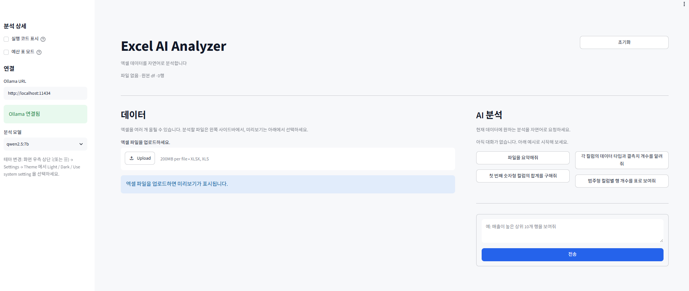
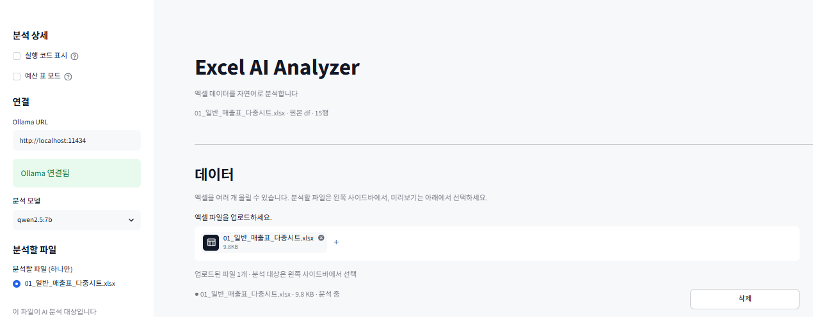
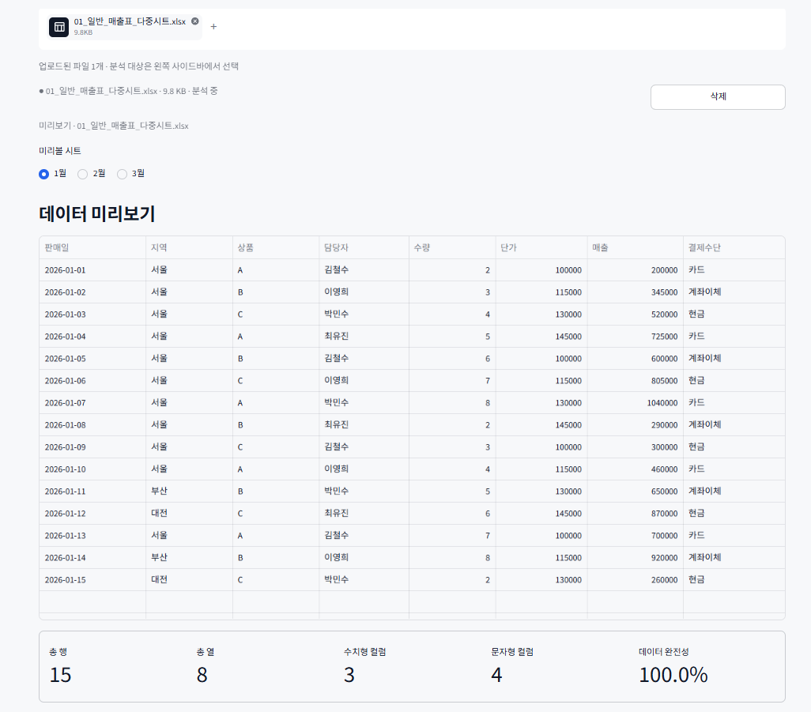
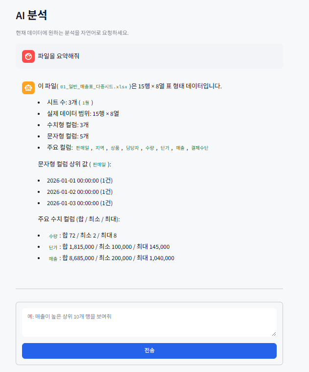
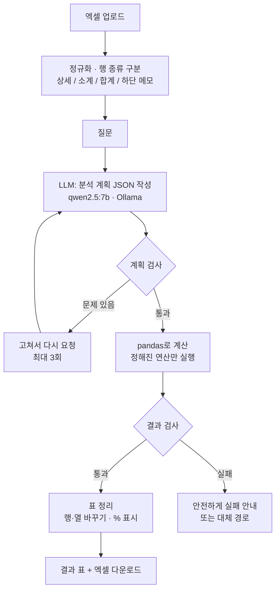

# Excel AI Analyzer

> 엑셀 파일을 올리고 자연어로 질문하면, 표로 된 분석 결과를 돌려주는 웹 앱입니다.

## 프로젝트 소개

엑셀 분석은 대부분 같은 작업의 반복입니다. 필요한 행을 고르고, 합계·평균을 내고, 비율을 계산하고, 보기 좋게 행과 열을 바꿉니다.
Excel AI Analyzer는 이 작업을 **질문 한 줄**로 대신하는 것을 목표로 합니다.

- **질문은 자연어로:** "연구활동비 항목들의 실행예산 합계 평균을 구해줘"
- **계산은 정확하게:** LLM은 *무엇을 할지(분석 계획)* 만 정하고, 실제 숫자 계산은 pandas가 합니다. LLM이 숫자를 직접 만들어 내지 않습니다.
- **결과는 바로 쓸 수 있게:** 결과 표 아래 버튼으로 엑셀(xlsx)을 내려받을 수 있습니다.
- **데이터는 밖으로 나가지 않게:** 오픈 모델(기본 `qwen2.5:7b`)을 사내 서버에서 [Ollama](https://ollama.com/)로 실행합니다. 외부 API를 쓰지 않습니다.

핵심 처리 구조는 특정 업무에 묶여 있지 않습니다. 다만 현재 기본 예시와 일부 규칙(소계·합계 행 구분 등)은 연구과제 **예실대비표**에서 가장 많이 검증되었습니다.

## Preview

### 🏠 메인 화면


### 📂 파일 업로드


### 👀 데이터 미리보기


### 🤖 AI 분석 결과


## 무엇을 할 수 있나요

예실대비표로 실제로 돌려 보고 결과 숫자까지 확인한 예제입니다.

| 하고 싶은 것 | 질문 예시 | 결과 |
| --- | --- | --- |
| 행과 열 바꾸기 | 비목분류별 계획예산, 실행예산 합계, 집행계 합계 표를 만들고 행과 열을 바꿔줘 | 분류별 요약표의 행과 열을 바꿔서 표시 |
| 고른 행을 뽑아서 바꾸기 | 국내여비, 국외여비, 회의비의 계획예산과 집행계 합계를 표로 보여주고 행과 열을 바꿔줘 | 바꾸기 전 표(① 추출한 표)와 바꾼 표(② 행과 열을 바꾼 표)를 차례로 표시 |
| 고른 행의 합계 | 국내여비, 국외여비, 회의비의 계획예산 합계를 구해줘 | 어떤 행을 더했는지 `구분` 열에 함께 표시 |
| 고른 행의 평균 | 연구활동비 항목들의 실행예산 합계 평균을 구해줘 | `연구활동비 (10개 항목)` 행에 `실행예산_합계`와 `실행예산_합계_평균`을 함께 표시 |
| 행마다 합계 | 연구활동비 항목들의 이월예산과 당해예산을 항목별로 더해줘 | 행마다 새 열로 계산 |
| 비율(집행률) | 연구활동비 항목들의 실행예산 합계 대비 집행계 합계 집행률을 항목별로 구해줘 | `집행률(%)` 열로 백분율 표시 |
| 전체 합계 | 계획예산 전체 합계를 구해줘 | `전체 (N개 항목)` 행으로 표시 |

그 밖에 파일 요약, 컬럼·결측치 확인, 조건으로 행 고르기, 정렬·상위 N개, 그룹별 집계, 여러 파일 비교·병합도 지원합니다.

## 동작 방식



1. **행 종류 구분:** 엑셀에 섞여 있는 소계·합계·빈 행·하단 메모를 먼저 구분합니다. 그래서 "합계"를 물어도 소계가 두 번 더해지지 않습니다.
2. **분석 계획:** LLM은 코드 대신 정해진 형식의 계획(JSON)만 씁니다. 사용할 수 있는 연산은 `filter_rows`, `aggregate`, `derive_column`, `ratio_of_aggregates`, `sort`, `limit`, `select_columns`, `compare_groups`, `top_per_group`, `correlation` 등으로 정해져 있습니다.
3. **검사와 재시도:** 없는 열 이름, 맞지 않는 연산 순서처럼 실행 전에 잡을 수 있는 문제는 계획을 고치거나 다시 받아서 해결합니다(최대 3회).
4. **계산:** 통과한 계획만 pandas로 실행합니다. 같은 계획이면 항상 같은 숫자가 나옵니다.
5. **결과 검사와 표시:** 결과가 질문과 맞는지 한 번 더 확인합니다. 그 뒤 행과 열을 바꾸거나, 비율 열에 `(%)`를 붙입니다.
6. **대체 경로:** 계획으로 풀 수 없는 질문은 값 찾기, 단순 그룹 집계, PandasAI 순서로 시도하고, 그래도 안 되면 틀린 답 대신 "처리하지 못했다"고 알려 줍니다. 비율을 묻는데 무엇으로 나눌지 정하지 못하면 대체 경로로 넘기지 않고 "A 대비 B"처럼 다시 적어 달라고 묻습니다.

## 현재 한계

- **비율의 기준:** "비목분류별 집행률"처럼 무엇 대비인지 적지 않으면, 다시 묻거나 AI가 기준 열을 골라 계산합니다(답변 문장에 고른 기준을 적음). "실행예산 합계 대비 집행계 합계 집행률"처럼 기준을 적으면 정확합니다.
- **표 구조 인식:** 소계·합계 행 구분은 예실대비표에서 가장 잘 검증되었습니다. 다른 형식의 표에서는 구분이 덜 정확할 수 있습니다.
- **모델 크기:** 7B 모델이라 질문이 길거나 조건이 많으면 계획을 잘못 세울 수 있습니다. 이때는 재시도와 검사가 막아 주지만, 질문을 나눠서 하는 편이 정확합니다.
- **해석 문장:** 결과 표 아래 설명 문장은 아직 다듬는 중입니다. `EXCEL_ANALYZER_DISABLE_INTERPRET=1`로 끌 수 있습니다.
- **대체 경로:** PandasAI 등 대체 경로의 결과는 계획 검증을 거치지 않습니다. headless·Hermes 응답에는 `validation_status: not_run`과 `unverified_fallback` 경고로 표시됩니다.

## Tech Stack

- **UI:** Streamlit
- **Backend:** Python 3.12, pandas, openpyxl / xlrd, PyYAML
- **LLM:** Ollama + 오픈 모델 `qwen2.5:7b` (사내 서버에서 실행)
- **대체 경로:** PandasAI
- **시각화:** matplotlib
- **Test / CI:** pytest, GitHub Actions

## Project Structure

```text
excel_ai_analyzer/
├── app.py                 # Streamlit 앱 진입점
├── core/
│   ├── analysis/          # 분석 계획 작성·검사·실행·결과 검사 (핵심)
│   ├── routing/           # 질문 종류 판별, 단일/다중 파일 라우팅
│   ├── schema/            # 스키마·품질·행 종류 구분
│   ├── io/                # 로딩·정규화·병합·export
│   ├── display/           # 결과 표시·차트
│   ├── integrate/         # 여러 파일 구조화 통합
│   ├── filter/            # 값·조건 필터
│   ├── summary/           # 파일 요약
│   ├── pai/               # PandasAI / Ollama 어댑터 (대체 경로)
│   ├── application/       # 화면 없이 호출하는 headless API · CLI
│   └── common/            # 재시도 등 공통 헬퍼
├── hermes/excel-analyzer/ # Hermes Agent skill (지침·연결 스크립트·설치 스크립트)
├── ui/                    # 업로드·미리보기·채팅·사이드바 화면
├── profiles/              # 표 종류별 규칙 YAML (generic, budget, sales, inventory …)
├── tests/                 # pytest 테스트
├── docs/                  # 문서·이미지
├── scripts/
├── .streamlit/config.toml
├── requirements.txt
└── run.sh
```

## Quick Start

**요구사항:** Python 3.12, Ollama 실행 중

```bash
# 1) 모델 받기 (기본값: qwen2.5:7b)
ollama pull qwen2.5:7b

# 2) 설치
git clone https://github.com/Jihei-Boun/excel_ai_analyzer.git
cd excel_ai_analyzer
python -m venv .venv
source .venv/bin/activate
pip install -r requirements.txt
# Python 3.12에서 PandasAI 의존성 충돌 시:
# pip install pandasai==2.3.2 --no-deps
# 그 다음 requirements.txt의 나머지 패키지를 설치

# 3) 실행
./run.sh                       # 기본 포트 8502
STREAMLIT_PORT=8503 ./run.sh   # 다른 포트로 실행
```

### 환경 변수

| 변수 | 기본값 | 설명 |
| --- | --- | --- |
| `OLLAMA_BASE_URL` | `http://localhost:11434` | Ollama 주소 |
| `OLLAMA_MODEL` | `qwen2.5:7b` | 분석 계획을 쓸 모델 |
| `STREAMLIT_PORT` | `8502` | `run.sh` 실행 포트 |
| `EXCEL_ANALYZER_DISABLE_INTERPRET` | (꺼짐) | `1`이면 결과 해석 문장 생성을 끔 |

### 화면 없이 호출하기

웹 화면 없이도 같은 분석을 쓸 수 있습니다. `core.application.headless.analyze_excel`을 직접 호출하거나, JSON 요청을 표준 입력으로 넘겨 CLI로 실행합니다.

```bash
python -m core.application.cli < request.json
```

### 다른 에이전트에서 쓰기 (Hermes Agent)

[Hermes Agent](https://hermes-agent.nousresearch.com/docs)의 skill로 이 분석기를 부를 수 있습니다. 에이전트는 무엇을 물을지만 정하고, 계산은 이 분석기가 합니다.
현재는 파일 요약·스키마·품질 진단과 셀·표 읽기를 지원합니다. 자유 질문 분석은 다음 작업입니다.

- 구조와 요청·응답 형식: [`docs/development/hermes.md`](docs/development/hermes.md)
- 설치와 실행: [`hermes/excel-analyzer/README.md`](hermes/excel-analyzer/README.md)

### 테스트

```bash
pytest
```

## Roadmap

### ✅ 완료

- [x] 엑셀(`xlsx/xls`)·CSV 업로드, 여러 파일·여러 시트 분석
- [x] 데이터 미리보기, 파일 요약, 스키마·품질 진단
- [x] **LLM 분석 계획 + pandas 계산** 구조로 전환 (계획 검사·최대 3회 재시도·결과 검사)
- [x] 소계·합계·하단 메모 행 자동 구분
- [x] 고른 행의 합계·평균에 행 이름(`구분`)과 합계 열 함께 표시
- [x] 행·열 바꾸기 전 표와 바꾼 표를 함께 표시
- [x] 비율 열을 `(%)` 백분율로 표시
- [x] 결과 표 엑셀(xlsx) 다운로드
- [x] 여러 파일 비교 병합 및 xlsx export
- [x] 표 종류별 규칙을 YAML 프로필로 분리, 업로드 기반 프로필 자동 추천
- [x] 화면 없이 호출하는 headless API · CLI
- [x] Hermes Agent skill 연결 (요약·스키마·품질, 셀·표 읽기)

### 🚀 다음 보완

- [ ] Hermes skill에 자유 질문 분석 추가
- [x] 그룹별 비율(예: 비목분류별 실행예산 합계 대비 집행계 합계 집행률) 지원
- [ ] 예실대비표가 아닌 표에서도 소계·합계 행 구분 정확도 높이기
- [ ] 결과 해석 문장 다듬기
- [x] 대체 경로 결과를 "검증 안 됨"으로 표시, 기준 없는 비율 질문은 되묻기
- [ ] PandasAI 대체 경로 결과 자체 검증
- [ ] 더 큰 모델과 정확도·속도 비교

### 🔭 확장 방향

- [ ] 예실대비표 외 업무 표(매출·재고·인사 등) 프로필 확대
- [ ] 여러 파일 자동 비교 리포트
- [ ] PDF 등 다른 입력 형식
- [ ] 차트 유형 확장 (라인/파이 등)

---

저장소: [Jihei-Boun/excel_ai_analyzer](https://github.com/Jihei-Boun/excel_ai_analyzer)
