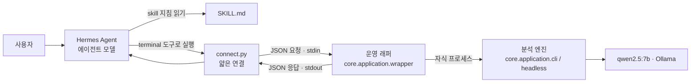

# Hermes Agent 연결

Excel AI Analyzer를 [Hermes Agent](https://hermes-agent.nousresearch.com/docs)(Nous Research)의 skill로 연결한 구조와 현재 상태를 정리한 문서입니다.
다른 에이전트에서 이 분석기를 부르려는 사람이 먼저 읽을 문서입니다.

- 설치·실행 방법: [`hermes/excel-analyzer/README.md`](../../hermes/excel-analyzer/README.md)
- 에이전트가 읽는 지침: [`hermes/excel-analyzer/SKILL.md`](../../hermes/excel-analyzer/SKILL.md)

## 한 줄 요약

에이전트는 **언제, 무엇을 물을지**만 정하고, 엑셀을 읽고 계산하는 일은 전부 이 분석기가 합니다. 에이전트는 분석기가 돌려준 JSON만 근거로 답합니다.

## 구조



| 계층 | 파일 | 하는 일 | 하지 않는 일 |
| --- | --- | --- | --- |
| skill 지침 | `hermes/excel-analyzer/SKILL.md` | 언제 쓰는지, 어떻게 부르는지, 응답을 어떻게 읽는지 에이전트에게 알려 줌 | 계산 |
| 연결 스크립트 | `hermes/excel-analyzer/connect.py` | 에이전트 인자를 검사해 래퍼 요청 JSON으로 바꾸고, 응답에서 공개할 필드만 골라 냄 (표준 라이브러리만 사용) | 계산·검증 복제, shell 실행 |
| 운영 래퍼 | `core/application/wrapper*.py` | 경로·크기·시간 제한, 작업 격리, 프로세스 정리, 응답 타입 검사, 산출물 공개 | 분석 로직 |
| 분석 엔진 | `core/application/headless.py`, `cli.py` | 웹 앱과 같은 분석을 화면 없이 실행 | 경로·자원 통제 |
| 셀·표 읽기 | `core/io/cell_reader.py`, `core/io/table_reader.py` | 지정한 셀 범위나 표를 LLM 없이 그대로 읽음 | 수식 재계산 |

### 왜 이렇게 나눴나

- **에이전트가 숫자를 만들지 못하게:** 에이전트 모델이 엑셀을 직접 열거나 Python으로 다시 계산하면 웹 앱이 가진 검사와 재시도를 모두 건너뜁니다. 그래서 skill 지침에 "직접 해석하거나 다시 계산하지 않는다"를 명시하고, 결과는 래퍼 JSON만 근거로 삼게 했습니다.
- **에이전트가 실행 환경을 고르지 못하게:** Python 경로, 모델 주소, 출력 위치, 허용 폴더는 요청이 아니라 운영 설정 파일에만 있습니다. 에이전트가 넘길 수 있는 것은 작업 종류, 파일 경로, 시트, 요청 ID(와 셀 주소·헤더 행)뿐입니다.
- **성공을 함부로 성공이라 하지 않게:** 모델 서버가 꺼져 있는데 `success`가 나가던 문제를 고쳤고, 엔진 응답의 타입이 계약과 다르면 실패로 처리합니다. 응답에는 항상 `semantic_correctness_guaranteed: false`가 들어갑니다. "실행이 정상으로 끝났다"와 "답이 맞다"는 다른 이야기라는 뜻입니다.

## 요청과 응답

### 에이전트 → 연결 스크립트

```bash
python3 ${HERMES_SKILL_DIR}/connect.py --task summary --file /절대/경로/파일.xlsx --sheet 0 --request-id hermes-summary-1
```

| 인자 | 필수 | 설명 |
| --- | --- | --- |
| `--task` | 예 | `summary`, `schema`, `quality`, `read_range`, `read_table` 중 하나 |
| `--file` | 예 | 허용 폴더 안의 절대 경로 |
| `--sheet` | 예 | 숫자면 시트 번호(0부터), 아니면 시트 이름 |
| `--request-id` | 예 | 호출을 구분하는 ID. 응답에만 남고 폴더 이름으로 쓰지 않음 |
| `--address` | `read_range`, `read_table`만 | 예: `B2`, `A4:C5` |
| `--header` | `read_table`만 | 헤더 행 번호. `3`, `3,4`, 또는 `none` |

### 지원 작업

| 작업 | 하는 일 | 엔진에 보내는 것 |
| --- | --- | --- |
| `summary` | 파일 요약 | 고정 질문 "이 파일의 주요 내용을 요약해줘" |
| `schema` | 컬럼 목록·타입 | 고정 질문 "컬럼 목록을 보여줘" |
| `quality` | 결측·중복 등 품질 진단 | 고정 질문 "이 파일의 데이터 품질을 분석해줘" |
| `read_range` | 셀·범위의 저장된 값과 수식 (최대 2000칸, `.xlsx`만) | `operation: read_range` + 주소 |
| `read_table` | 범위와 헤더 행을 지정한 표 하나 (최대 2000칸, `.xlsx`만) | `operation: read_table` + 주소 + 헤더 |

### 연결 스크립트 → 래퍼 (계약 1.0)

```json
{
  "contract_version": "1.0",
  "request_id": "hermes-summary-1",
  "user_prompt": "이 파일의 주요 내용을 요약해줘",
  "inputs": [{"path": "/허용/폴더/sales.xlsx", "sheet": 0, "display_name": "sales.xlsx"}],
  "profile_name": "generic",
  "analysis_mode": "single"
}
```

`read_range`, `read_table`은 `user_prompt` 대신 `"operation": "read_range"`와 `"read": {"address": "A4:C5"}`(표는 `"header": {"rows": [3]}` 추가)를 보냅니다.

### 응답에서 볼 것

| 필드 | 뜻 |
| --- | --- |
| `status`, `wrapper_exit_code` | `success`이고 `0`일 때만 성공 |
| `text`, `data` | 요약·스키마·품질의 답변 근거 |
| `cells` / `table` | 셀·표 읽기 결과. 빈 칸과 병합으로 가려진 칸도 그대로 |
| `safety.validation_status` | (엔진·래퍼 응답) 분석 계획 검증을 통과했으면 `passed`. PandasAI 같은 대체 경로 결과면 `not_run` |
| `warnings[].code` | (엔진·래퍼 응답) `unverified_fallback`이면 계획 검증 없이 대체 경로로 만든 결과 |
| `structural_state` | 결과 구조 검사를 했는지(`passed`/`failed`/`not_run`/`unknown`). `passed`여도 의미가 맞다는 보증은 아님 |
| `input_integrity` | 실행 전후 입력 파일 해시가 같으면 `unchanged` |
| `artifacts` | 실제로 만들어진 결과 파일만. `exists`가 true일 때만 파일이 있다고 말함 |
| `error.code`, `error.message` | 실패 이유 |

| status | 종료 코드 |
| --- | --- |
| `success` | 0 |
| `execution_failed` | 1 |
| `invalid_request` (예: `missing_file`, `missing_address`) | 2 |
| `cannot_plan` (예: `rate_needs_operands` 비율 기준을 정하지 못함, `safe_plan_failure` 없는 열) | 3 |
| `validation_failed` | 4 |
| `model_unavailable` | 5 |
| `timeout` | 6 |
| `cancelled` | 7 |
| `busy` | 8 |

`safety`와 `warnings`는 엔진·래퍼 응답에만 있고, 지금의 `connect.py`는 에이전트에게 넘기지 않습니다. 고정 질문과 셀·표 읽기에는 대체 경로가 없기 때문입니다. 자유 질문(`analyze`)을 추가할 때 함께 넘겨야 합니다.

## 래퍼의 안전장치

- **경로:** 실제 경로(`realpath`)로 바꾼 뒤 허용 폴더 안인지 확인합니다. `..`, 심볼릭 링크, 폴더 밖 파일은 실행 전에 거절합니다.
- **입력 보호:** 원본 대신 읽기 전용 작업 사본으로 실행하고, 실행 전후 해시를 비교합니다. 결과 파일이 원본을 덮어쓰지 못합니다.
- **격리:** 실행마다 서버가 만든 32자 실행 ID로 작업 폴더를 만듭니다. 같은 요청 ID가 다시 와도 이전 결과를 덮어쓰지 않습니다.
- **자원 제한:** 파일 수·크기, 요청 크기, 출력 크기, 실행 시간을 운영 설정으로 제한합니다. 시간이 넘으면 `SIGTERM` → `SIGKILL`로 프로세스 그룹까지 정리하고, 정리를 확인하지 못하면 성공으로 내보내지 않습니다.
- **동시 실행:** 한 작업 폴더에서는 한 번에 하나만 실행합니다(`flock`). 기다리다 시간이 넘으면 `busy`.
- **경로 비공개:** 셀·표 읽기 응답에는 입력 절대 경로와 작업 폴더 경로가 나가지 않습니다.

이 장치들은 사고를 막는 운영 경계이지 보안 샌드박스는 아닙니다. 같은 OS 사용자는 권한을 되돌릴 수 있습니다.

## 검증한 범위

Hermes Agent v0.22.0 + 에이전트 모델 `gemma4`(컨텍스트 64000) + 엔진 `qwen2.5:7b`로 실제 세션을 돌려 확인했습니다.

| 작업 | 실제 Hermes 세션 | 결과 |
| --- | --- | --- |
| `summary`, `schema`, `quality` | 각 1회 (2026-10-15) | 성공 |
| 없는 파일 | 1회 | 기대한 대로 `missing_file`, 종료 2 |
| `read_range` | 단일 셀, 병합 범위, 수식, 역순 범위 | 지침 보완(1.1.0 → 1.1.2) 후 모두 기대대로 답변 |
| `read_table` | 실행 안 함 | 연결과 모델 없는 테스트만 완료 |

모델 없이 도는 테스트는 `pytest`에 포함되어 있습니다. 실제 Hermes를 부르는 테스트는 `HERMES_EXCEL_E2E=1`일 때만 실행됩니다.

## 아직 안 된 것

- **자유 질문(`analyze`)이 skill에 없습니다.** 엔진은 이미 자유 질문을 받지만, skill은 고정 질문 세 개와 셀·표 읽기만 노출합니다. 행·열 바꾸기, 합계, 평균, 집행률 같은 분석을 Hermes에서 쓰려면 이 작업을 추가해야 합니다. **다음 작업입니다.**
- **자동 발견:** 지금은 프로필 설정(`skills.auto_load`)으로 skill을 항상 불러옵니다. 에이전트가 스스로 skill을 찾아 쓰는지는 확인하지 않았습니다.
- **반복 안정성:** 각 사례를 1회씩 실행했습니다. 같은 질문을 여러 번 했을 때 답이 일정한지는 확인하지 않았습니다.
- **답변 자동 검증:** 에이전트의 최종 답변이 래퍼 결과와 맞는지는 일부만 자동으로 검사했고, 나머지는 사람이 대조했습니다.
- **범위:** 파일 하나, 같은 Linux 서버의 절대 경로만 지원합니다. 여러 파일 통합, 셀 편집, 수식 재계산은 지원하지 않습니다.
- **Hermes의 자기 개선 기능:** Hermes는 경험에서 skill을 만들고 고칩니다. 이 skill의 지침("직접 계산하지 않는다" 등)이 바뀌면 안전장치가 약해지므로, 이 skill은 사람이 관리하는 것을 원칙으로 합니다.
- **알려진 결함:** 여러 파일 통합에서 매출이 0으로 나오는 문제가 남아 있습니다(이 skill의 범위 밖).

## 기록

단계별 개발 기록(DEV-0 기준 측정 ~ DEV-5 표 조회, 설계·검토·측정 결과)은 로컬 브랜치 `wip/hermes-skill`에 원본 그대로 보존되어 있습니다.
테스트용 합성 엑셀과 기준 측정 스크립트는 `docs/development/dev0/`에 남아 있습니다.
