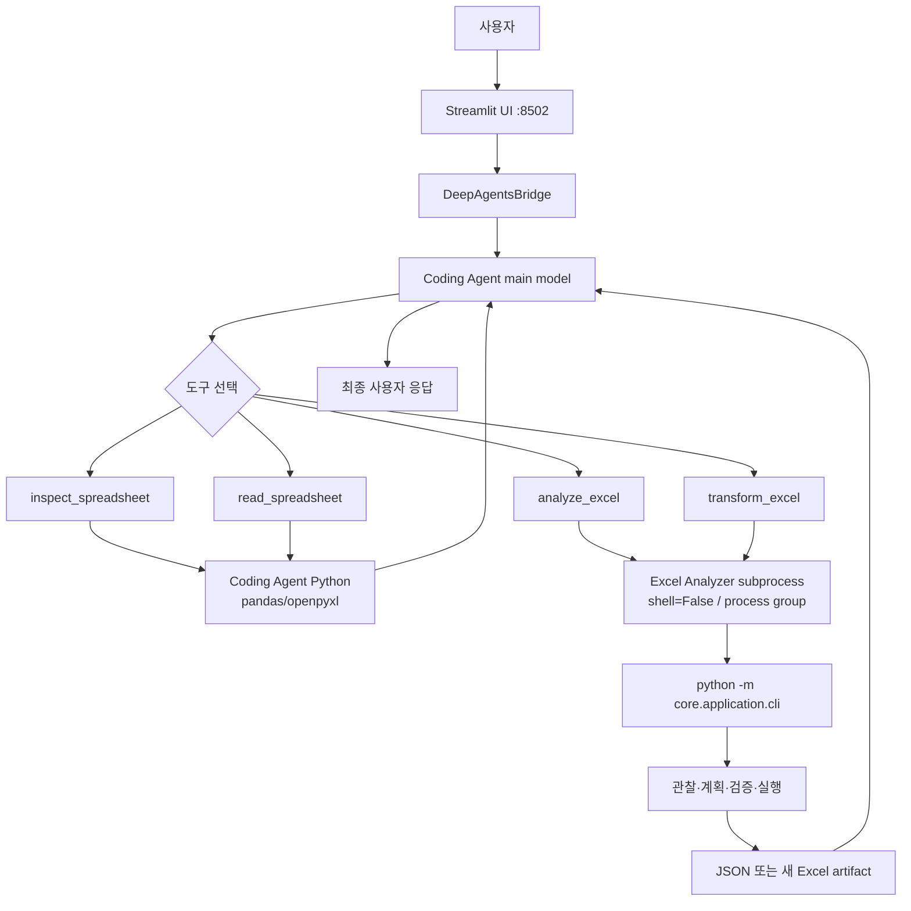

# Coding Agent × Excel Analyzer — 센터장 시연 준비 가이드

> **문서 성격:** 시연·설명용 준비 문서 (Phase I2-H0)  
> **작성 기준일:** 2026-09-10  
> **원칙:** 홍보 문구·추정이 아니라 **현재 코드·검증 결과**만 기록한다.  
> **이번 Phase에서 하지 않은 것:** live UI 재실행, LLM 호출, 코드·설정·모델·서버·Excel 파일 변경.

관련 companion:

- `docs/excel_integration.md` — 통합 기술 설명
- `docs/manual_excel_integration_test_plan.md` — 수동 테스트 계획
- `docs/manual_excel_integration_expected_results.md` — 판정 oracle

---

## 목차

1. [한 줄 요약](#1-한-줄-요약)
2. [센터장님이 지정한 시연 범위](#2-센터장님이-지정한-시연-범위)
3. [확인된 저장소·런타임 상태](#3-확인된-저장소런타임-상태)
4. [시스템 연계 구조](#4-시스템-연계-구조)
5. [쉬운 비유와 기술 설명](#5-쉬운-비유와-기술-설명)
6. [시연 가능 상태 판정](#6-시연-가능-상태-판정)
7. [시연 시나리오 (Level 1–3)](#7-시연-시나리오-level-13)
8. [실제 시연 스크립트](#8-실제-시연-스크립트)
9. [예상 질문과 모범 답변](#9-예상-질문과-모범-답변)
10. [시연 전 체크리스트](#10-시연-전-체크리스트)
11. [발표자료 목차 초안](#11-발표자료-목차-초안)
12. [시연 전 Blocker 요약](#12-시연-전-blocker-요약)
13. [근거 색인](#13-근거-색인)

---

## 1. 한 줄 요약

Coding Agent UI에서 Excel **조회·구조 확인·일부 분석·원본 보존 변환**을 자연어로 보여줄 수 있는 **통합 경로(도구·subprocess·workspace 격리)**는 준비되어 있다.  
다만 센터장님 예시 **요청 A(복합 추출)** 는 live/research 모두 **의미 정확도 미달(0/3)** 이고, **요청 B(병합 해제)** 는 planner 기준으로는 안정적이나 **UI E2E 재검증·녹화 대비가 필요**하다.  
한국어 최종 응답은 메인 모델(`qwen2.5:7b`)에서 중국어로 바뀌는 사례가 있어 **시연 전 언어 smoke가 blocker**다.

---

## 2. 센터장님이 지정한 시연 범위

### 2.1 시연 방향 (원문 취지)

> Excel을 입력하고, 데이터를 변경·조회·수정하는 등 Excel에 관련된 기능만 자연어로 보여주면 된다.

이 문서의 시연 범위는 **코드 편집·일반 셸 작업이 아니라 Excel 관련 자연어 경로**로 한정한다.

### 2.2 요청 A — 선택 데이터 추출

| 항목 | 내용 |
|---|---|
| 대상 파일 | `04_분산_예실대비표.xlsx` |
| 취지 | 실행예산 중 **당해예산** 열, **내부인건비·재료비** 행만 추출해 **다른 sheet**로 옮기기 |
| 작업(oracle) | `extract_to_sheet` |
| 원본 header rows | 1–2 |
| 대상 data rows | 3–5, 21–22 |
| 대상 columns | A, C, F |
| 제외 | E, G, I–L 등 요청하지 않은 sibling/다른 예산 열 |
| 산출 | 새 sheet 또는 별도 결과 workbook |
| 원본 | SHA 불변 |

**주의:** 위 좌표는 **테스트·문서 acceptance oracle**이다. production routing/코드에 하드코딩하면 안 된다.

#### 요청 A acceptance oracle (문서 전용)

| Excel source row | A (stored) | C (stored) | F (당해예산) | 포함 |
|---:|---|---|---:|---|
| 1–2 | header | header | header (`F2=당해예산`) | 포함 |
| 3 | `내부인건비` | `내부인건비` | `31610000` | 필수 |
| 4 | *(stored empty)* | `계약직내부인건비` | `17643000` | 필수 |
| 5 | `소 계` | *(empty)* | `49253000` | 필수 |
| 21 | `연구재료비` | `재료비` | `1858000` | 필수 |
| 22 | `소 계` | *(empty)* | `1858000` | 필수 |
| 6–20, 23–29 | — | — | — | 포함 시 FAIL |

### 2.3 요청 B — 병합 셀 개별 셀화

| 항목 | 내용 |
|---|---|
| 취지 | 병합된 셀을 개별 셀로 나누고, 병합 값을 각 셀에 채우기 |
| 작업(oracle) | `unmerge_cells` |
| 범위 | 모든 병합 영역 (`all_merged_ranges`) |
| fill policy | `fill_all` |
| 원본 merge | **14**개 |
| 결과 merge | **0**개 |
| 값 전파 | 각 병합 영역 top-left 값을 분리된 모든 셀에 전파 |
| 원본 | SHA 불변 |
| 산출 | 새 파일 artifact |

fill_all 샘플:

| Merge | Top-left | 전파 값 |
|---|---|---|
| `A1:A2` | A1 | `비목분류` |
| `B1:C2` | B1 | `비용명` |
| `E1:G1` | E1 | `실행예산` |
| `A27:C27` | A27 | `내부흡수액` |

---

## 3. 확인된 저장소·런타임 상태

> 아래 값은 Phase I2-H0 작성 시점(2026-09-10)에 **읽기 전용**으로 재확인했다.  
> 기존 사용자 변경사항은 수정·정리·stage·commit하지 않았다.

### 3.1 Coding Agent

| 항목 | 확인값 |
|---|---|
| 경로 | `/home/raven323/Project/coding_agent` |
| branch | `fix/spreadsheet-workspace-paths` |
| HEAD | `58fcc735aa838f578c34d705a50681d4fd4828f6` |
| 메시지 | `fix: accept workspace-contained absolute spreadsheet paths` |
| `origin/main` | `b0f230706f852c4e6289e68a266fda3393364f17` (`Merge pull request #2 … excel-integration`) |
| remote 대비 | **ahead 1** (path fix **미 push / PR 없음**) |
| staged | 없음 |
| untracked | `docs/manual_excel_integration_test_plan.md`, `docs/manual_excel_integration_expected_results.md` (+ 본 문서 작성 후 본 파일) |
| tracked dirty | 없음 |

### 3.2 Excel Analyzer

| 항목 | 확인값 |
|---|---|
| 경로 | `/home/raven323/Project/excel_ai_analyzer` |
| branch | `i2-excel-capability` |
| HEAD | `3a1eff5724d41b67861c8d2e093fbdb0db189217` |
| working tree | **dirty** — D4 research (two-stage planner 등) modified/untracked |
| production CLI wiring | `cli.py` → `transform_excel_from_prompt` → **one-stage** `plan_transformations` |
| two-stage | research-only (`transform_two_stage_planner.py` 등). **CLI/production 미연결** |

### 3.3 실행 중 UI / Ollama

| 항목 | 확인값 |
|---|---|
| Coding Agent UI | Streamlit **port 8502**, health `ok` (pid `832068`) |
| 다른 Streamlit | port **8501** (`hsri20` excel-chatbot) — **본 시연 대상 아님** |
| Ollama | `127.0.0.1:11434` LISTEN |
| 설치 모델 (일부) | `qwen2.5:7b`, `qwen3:32b`, `gemma4:latest`, `gemma:latest`, … |
| `gemma4:31b` | **미설치** |

### 3.4 UI가 실제 사용하는 Excel Analyzer root

시연용 demo env (`/tmp/coding-agent-excel-demo-env.sh`) 및 I2-G0 런타임 감사 근거:

| 환경변수 | 값 |
|---|---|
| `CODING_AGENT_EXCEL_ROOT` | `/tmp/excel-ai-analyzer-demo-3a1eff5` |
| `CODING_AGENT_EXCEL_PYTHON` | `/tmp/excel-ai-analyzer-demo-3a1eff5/.venv/bin/python` |
| `CODING_AGENT_EXCEL_MODEL` | `qwen2.5:7b` |
| `CODING_AGENT_EXCEL_OLLAMA` | `http://localhost:11434` |
| `CODING_AGENT_EXCEL_TIMEOUT` | `180` |
| `CODING_AGENT_EXCEL_OUTPUT_ROOT` | `…/coding_agent/workspace/outputs/excel_agent` |

| 구분 | 내용 |
|---|---|
| demo worktree SHA | `3a1eff5…` (HEAD와 동일 commit) |
| demo에 포함된 기능 | production transform (observe → **one-stage plan** → execute), analyze CLI |
| demo에 **없는** 기능 | D4 two-stage / grounding validator / assemble 모듈 |
| dirty research tree | UI subprocess에 **미사용** |

### 3.5 모델

| 역할 | disk default | 실측 시연 세션 | 비고 |
|---|---|---|---|
| Coding Agent main | `gemma4:31b` (`config.py`) | 수동 테스트 thread는 **`qwen2.5:7b`** | exact `gemma4:31b` 미설치 |
| Excel Analyzer | `qwen2.5:7b` | UI env도 `qwen2.5:7b` | main과 **분리** |

### 3.6 시연 workbook

| 항목 | 값 |
|---|---|
| 경로 | `/home/raven323/Project/coding_agent/workspace/04_분산_예실대비표.xlsx` |
| size | 7251 bytes |
| SHA-256 | `a4c66ccaf708563f02eaa7367e12fde31d1eb02178b8b4760cef53ea8941f4d4` |
| Sheet | `Sheet1` |
| merge | 14 |
| 이번 Phase | **읽기·수정 없음** (SHA 재확인만) |

### 3.7 Path bugfix / PR / D4 포함 여부

| 항목 | 상태 |
|---|---|
| PR #2 Excel 통합 | `origin/main`에 merge됨 (`b0f2307`) |
| path fix | 로컬 commit `58fcc73` — workspace 내부 absolute path 허용, 외부·sibling-prefix·symlink 차단 |
| pytest | **110 passed** (I2-F1/F3) |
| UI E2E | inspect/read absolute path **성공** (I2-F2) |
| push/PR | **아직 없음** (origin/main 대비 ahead 1) |
| D4 research | dirty tree에 존재, **demo/UI 경로에는 미포함** |
| 요청 A/B UI live | 수동 계획상 **NOT_RUN** (oracle만 준비). 연구 live는 §6·§7 참조 |

### 3.8 센터장 요청 A/B의 UI 경로 실행 가능 여부

| 요청 | UI에서 도구 호출 가능한가? | 의미적 성공이 보장되는가? |
|---|---|---|
| A 복합 추출 | **예** — `transform_excel` → Analyzer CLI (one-stage) | **아니오** — planning/research 모두 안정 PASS 미달 |
| B 병합 해제 | **예** — 동일 transport | **조건부** — D4C planning 3/3·product policy `fill_all` 있으나 UI E2E 미완·사전 dry-run 필요 |

---

## 4. 시스템 연계 구조

### 4.1 전체 흐름 (Mermaid)



**중요:** 모든 도구가 subprocess를 쓰는 것은 **아니다**.

### 4.2 도구별 역할 구분

| 도구 | 역할 | Excel Analyzer subprocess | 내부 LLM |
|---|---|---:|---:|
| `inspect_spreadsheet` | 파일 구조·시트·열 확인 | 아니오 | 아니오 |
| `read_spreadsheet` | 제한된 데이터 읽기 | 아니오 | 아니오 |
| `analyze_excel` | Excel 분석 | 예 | route에 따라 조건부 |
| `transform_excel` | 자연어 Excel 변환 | 예 | planner에서 예 |

근거:

- `coding_agent/spreadsheet.py` — inspect/read는 프로세스 내 deterministic
- `coding_agent/tools/excel_tool.py` + `integrations/excel_subprocess.py` — analyze/transform만 CLI subprocess
- demo `transform_prompt_headless.py` — `plan_transformations` (one-stage)

### 4.3 설계 원칙 (센터장 설명용)

| 원칙 | 의미 | 코드/동작 근거 |
|---|---|---|
| LLM = 의도·semantic planning | 자연어 해석, 변환 계획 | Analyzer planner `chat_json` |
| Python = 관찰·검증·실행 | 구조 관찰, 안전 검사, deterministic execution | observer / executor / CA path validation |
| Validator | 근거가 틀리면 실행 차단 | research grounding validator; production도 fail-closed plan 거부 |
| subprocess isolation | Coding Agent와 Analyzer 환경 분리 | 전용 venv Python, import 금지 |
| workspace containment | 허용 workspace 밖 차단 | `resolve_under_workspace`, excel path validators |
| source immutability | 원본 덮어쓰기 금지 | request SHA 검사, `TRANSPORT_SOURCE_MUTATED` |
| artifact validation | 결과 경로·존재·형식 확인 | `validate_artifacts` |
| `shell=False` | shell injection 최소화 | `Popen(..., shell=False)` |
| timeout / process group | 장시간 프로세스 종료 | `start_new_session=True`, `os.killpg` |

### 4.4 production vs research

| 구분 | 포함 | 현재 UI(demo) |
|---|---|---|
| production | one-stage planner, executor, analyze headless, CA tools | **사용 중** |
| research (D4) | two-stage planner, grounding contracts/validator, assemble | **미연결** |
| 문서 oracle 좌표 | Scenario A/B 행·열 | **코드에 삽입 금지** |

---

## 5. 쉬운 비유와 기술 설명

| 개념 | 쉬운 비유 | 실제 기술 |
|---|---|---|
| Coding Agent | 작업을 배분하는 **관리자** | Streamlit + DeepAgentsBridge + main LLM이 도구 선택 |
| Excel Analyzer | Excel **전문 작업자** | 별도 저장소·venv, CLI subprocess |
| inspect/read | 파일을 열어 구조와 일부 내용을 확인 | CA 프로세스 내 pandas/openpyxl, LLM 없음 |
| analyze | 데이터의 의미·수치를 분석 | subprocess → routing (deterministic 또는 LLM) |
| transform | 원본을 보존하며 **새 결과 파일** 작성 | observe → plan → execute → `outputs/excel_agent/<id>/` |
| Validator | 지시가 실제 Excel과 맞는지 보는 **검수자** | evidence/observation 불일치 시 plan 차단 |
| subprocess | 분리된 **작업실**에서 실행 | 환경·의존성·장애 격리 |

한 문장 요약:

> 관리자(Coding Agent)가 “무엇을 할지” 정하고, 전문 작업자(Excel Analyzer)가 Excel만 다루며, 검수자(Validator/Python)가 틀린 좌표로 원본을 망가뜨리지 않게 막습니다.

---

## 6. 시연 가능 상태 판정

판정 정의:

| 상태 | 의미 |
|---|---|
| `READY` | 시연에 쓸 수 있고, 성공 기대가 합리적 |
| `READY_WITH_LIMITATION` | 보여줄 수 있으나 한계·확률·사전 확인 필요 |
| `NOT_READY` | 성공을 주장하거나 첫 항목으로 시연하면 안 됨 |
| `BLOCKED` | 환경/모델/미검증으로 시연 자체가 막힘 |
| `UNKNOWN` | 이번 Phase에서 재확인하지 못함 |

| # | 기능 | 판정 | 근거 |
|---:|---|---|---|
| 1 | workspace Excel 파일 목록 | `READY` | Files explorer + workbook 존재 확인 |
| 2 | 파일 구조 확인 | `READY` | `inspect_spreadsheet` + I2-F2 E2E absolute path 성공 |
| 3 | 일부 데이터 읽기 | `READY` | `read_spreadsheet` + I2-F2 E2E |
| 4 | 단일값 조회 | `READY_WITH_LIMITATION` | oracle `F3=31610000` 등 존재; 최종 응답 중국어 위험 (I2-G0) |
| 5 | 자연어 분석 | `READY_WITH_LIMITATION` | `analyze_excel` transport 존재; 의미·언어는 모델 의존 |
| 6 | 일반 Excel 변환 | `READY_WITH_LIMITATION` | `transform_excel` + CLI; semantic은 시나리오별 |
| 7 | 요청 A 복합 추출 | `NOT_READY` | D4C one-stage A **0/3**; D4M two-stage A **0/3** (evidence mismatch로 assembly 차단). 성공 보장 금지 |
| 8 | 요청 B 병합 해제+채우기 | `READY_WITH_LIMITATION` | D4C planning B **3/3** (`qwen2.5:7b`); product `fill_all`. 단 UI E2E는 수동 계획 `NOT_RUN`. two-stage는 production 미연결 |
| 9 | 새 artifact 생성·확인 | `READY_WITH_LIMITATION` | request-scoped `outputs/excel_agent/`; Files 노출. download UX는 알려진 제한 가능 |
| 10 | 한국어 최종 응답 | `BLOCKED` (보장 시) / `READY_WITH_LIMITATION` (시도 시) | raw tool은 한글이나 main `qwen2.5:7b` 최종 응답이 중국어로 바뀐 사례 다수 |
| 11 | 원본 보존 | `READY` | source SHA 계약 + D4/D4M 전후 SHA 불변 기록 |
| 12 | 모델 전환 (`gemma4:31b`) | `NOT_READY` / `BLOCKED` | exact tag 미설치; I2-G0 `NOT_READY` |

**센터장 앞에서 성공이 보장된 것처럼 말하면 안 되는 것:** 요청 A.  
**요청 B:** “가능 후보라”고만 말하고, 시연 직전 dry-run 또는 녹화 artifact를 준비한다.

---

## 7. 시연 시나리오 (Level 1–3)

공통 규칙:

- 주요 단계마다 **새 thread**
- Agent details에서 실제 tool·path 확인
- 동일 오류 2회면 중단
- 원본 SHA 변경 시 즉시 중단
- 실패 가능 항목을 **첫 시연으로 두지 않음**

### Level 1 — 안전하게 보여줄 기능

#### L1-1 workspace 파일 확인

**prompt:**

```text
workspace에 어떤 Excel 파일이 있는지 목록만 알려줘. 내용은 열지 마.
```

| 항목 | 내용 |
|---|---|
| 예상 tool | Files/`ls`류 또는 읽기 전용 목록. `transform_excel` 금지 |
| 기대 결과 | `04_분산_예실대비표.xlsx` 언급 |
| PASS | 파일명 확인, 원본 미수정 |
| 중단 | 원본 수정·삭제 시도 |
| 설명 한 줄 | “먼저 workspace에 올라온 Excel을 확인합니다.” |

#### L1-2 시트·행·열·주요 열 확인

**prompt:**

```text
workspace의 04_분산_예실대비표.xlsx 파일 구조를 확인하고, 시트 이름과 행·열 크기, 주요 열 이름만 알려줘.
```

| 항목 | 내용 |
|---|---|
| 예상 tool | `inspect_spreadsheet` |
| 기대 | Sheet1; inspect 기준 rows≈28, columns=18; 열에 `비목분류`, `비용명`, `실행예산` 등 |
| 기준값 | openpyxl used range `A1:R29`, merge 14 (inspect rows는 header 소비로 28일 수 있음 — 오류 아님) |
| PASS | 구조 사실 일치, analyze/transform 불필요 호출 없음 |
| 중단 | path 오류 2회 반복 |
| 설명 | “파일을 열어보지 않고도 구조만 빠르게 확인하는 도구입니다.” |

#### L1-3 일부 행 읽기

**prompt:**

```text
04_분산_예실대비표.xlsx의 Sheet1에서 처음 몇 행만 읽어서 표 구조를 보여줘.
```

| 항목 | 내용 |
|---|---|
| 예상 tool | `read_spreadsheet` (또는 inspect 후 read) |
| 기대 | 상위 행/다단 헤더 흔적 표시 |
| PASS | 제한 행만 읽고 원본 불변 |
| 중단 | transform으로 대체 |
| 설명 | “필요한 구간만 잘라 읽는 조회입니다.” |

#### L1-4 단일값 조회

**prompt:**

```text
04_분산_예실대비표.xlsx Sheet1에서 비용명이 '내부인건비'인 행의 실행예산 중 당해예산(열 F) 숫자만 알려줘. 합계 행은 제외해.
```

| 항목 | 내용 |
|---|---|
| 예상 tool | `read_spreadsheet` 또는 `analyze_excel` |
| 기준값 | **31610000** (`F3`) |
| PASS | 값 정확 + 한국어 응답(이상) + 원본 불변 |
| FAIL | E3(이월) 답변, 소계 F5만 답, 중국어만 출력 |
| 중단 | 중국어만 나오면 언어 blocker로 기록 후 Level 1 축소 또는 모델 정책 재검토 |
| 설명 | “자연어로 특정 셀 값을 조회할 수 있습니다.” |

#### L1-5 원본 미수정 간단 분석

**prompt:**

```text
04_분산_예실대비표.xlsx를 기준으로 주요 비목별 예산·집행 경향을 자연어로 요약해줘. 원본 파일은 수정하지 마.
```

| 항목 | 내용 |
|---|---|
| 예상 tool | `analyze_excel` |
| 기대 | 요약 텍스트; artifact가 있으면 `outputs/excel_agent/` 하위 |
| PASS | 요약 제공 + source SHA 불변 + transform 오용 없음 |
| 한계 | open-ended라 문장 일치 불필요. 틀린 핵심 숫자는 FAIL |
| 설명 | “분석은 복사본/결과 영역에서 이뤄지고 원본은 그대로입니다.” |

---

### Level 2 — 제한을 설명하고 보여줄 기능

#### L2-1 단순 변환 / 새 결과 파일 (semantic 엄격 X)

**prompt:**

```text
04_분산_예실대비표.xlsx에서 병합된 셀이 있으면 병합을 해제하고, 각 개별 셀에서 쓸 수 있는 형태의 복사본을 만들어줘. 원본은 변경하지 마.
```

| 항목 | 내용 |
|---|---|
| 예상 tool | `transform_excel` (`unmerge_cells`) |
| 기대 | 새 xlsx under `outputs/excel_agent/<request_id>/` |
| PASS (smoke) | artifact 생성 + source SHA 불변 + merge 감소 방향 |
| 엄격 PASS | Level 3-B oracle (14→0, fill_all) |
| 한계 설명 | “결과는 항상 새 파일로 남기고, 원본 SHA를 검증합니다.” |
| 시연 전 | **반드시 dry-run** (아래 Level 3-B와 동일 계열) |

#### L2-2 artifact 위치 확인

시연자 확인 절차:

1. tool_result의 artifact path 기록
2. Files explorer에서 동일 경로 확인
3. 원본 `04_분산_예실대비표.xlsx` size/SHA 재확인

| 판정 | 기준 |
|---|---|
| PASS | path가 workspace 내부 `outputs/excel_agent/` + 원본 불변 |
| FAIL | 원본 overwrite, workspace 밖 경로 |

---

### Level 3 — 센터장 요청이나 검증이 필요한 기능

#### L3-A 요청 A — 복합 추출

**센터장 취지에 가까운 prompt:**

```text
이 파일에서 실행예산 중 당해예산, 내부인건비, 재료비만 추출해서 다른 sheet에 옮겨줘.
```

| 항목 | 내용 |
|---|---|
| acceptance oracle | §2.2 표 (rows 3–5·21–22, cols A/C/F, exclude E/G/I–L) |
| 현재 구현 | production one-stage `extract_to_sheet` **가능** |
| production 연결 | **예** (CLI → one-stage) |
| research two-stage | **미연결**; D4M에서도 A **0/3** |
| 기존 live | D4C planning A **STABLE_FAIL 0/3**; D4M A **0/3** (`conflicting_evidence` / `evidence_value_mismatch` 등으로 assembly 차단) |
| 시연 전 필요 | 성공 녹화·사전 artifact **또는** “현재 한계”로만 설명. live 첫 항목 금지 |
| 실패 위험 | **높음** — 행 범위 과다 선택, 식별열 누락, sibling 열 포함 |
| 대체 | Level 1 조회(`F3`/`F21`)로 “필요한 숫자를 찾는 능력”을 보여주고, 추출은 연구 중이라고 명시 |

**판정 문구 (권장):**  
「요청 A는 도구 경로는 열려 있으나, 의미적으로 정확한 행·열만 고르는 능력이 아직 안정적이지 않습니다. 성공으로 발표하지 않습니다.»

#### L3-B 요청 B — 병합 셀 개별 셀화

**센터장 취지에 가까운 prompt:**

```text
여러 셀이 병합된 경우 병합을 해제하고 각 개별 셀에서 사용할 수 있는 형태로 만들어줘.
```

| 항목 | 내용 |
|---|---|
| acceptance oracle | merge 14→0, `fill_all`, source SHA 불변, 새 artifact |
| 현재 구현 | production `unmerge_cells` + adapter policy `fill_all` |
| production 연결 | **예** (one-stage). two-stage research **아니오** |
| 기존 live | D4C planning B **3/3** (`qwen2.5:7b`); D4M research B **3/3** (planning). D4 초기 end-to-end는 오선택 사례 있음 → **시연 전 dry-run 필수** |
| 시연 전 필요 | UI 새 thread dry-run 1회 + artifact 열어 merge=0 확인 + 녹화 백업 |
| 실패 위험 | 중간 — op 오선택(extract로 빠짐), fill 미적용, timeout |
| 대체 | 사전 생성 artifact를 Files에서 열어 “결과 형태”만 시연하고, live는 생략 |

---

## 8. 실제 시연 스크립트

대상 발표자: **지혜**.  
UI: `http://localhost:8502` (확인 필요).  
모델: 시연 직전 thread model·Excel model 재확인.

### 8.1 30초 도입

**말할 내용:**  
「오늘은 Coding Agent가 Excel 전문 모듈인 Excel Analyzer와 어떻게 역할을 나눠, 자연어로 파일을 조회·분석·변환하는지 보여드리겠습니다. 원본 파일은 덮어쓰지 않고, 결과는 별도 파일로 남깁니다.」

| 항목 | 내용 |
|---|---|
| UI prompt | (없음) |
| 화면 확인 | UI 로딩, 새 thread, workspace에 `04_분산_예실대비표.xlsx` |
| 정상 시 | 시연 목적만 짧게 |
| 실패 시 | UI health 실패면 시연 중단 (`시연 전 blocker`) |
| 다음 조건 | UI `ok`, Ollama up, workbook 존재 |

### 8.2 Excel 파일 입력 설명

**말할 내용:**  
「시연에 쓰는 파일은 센터에서 쓰시는 형태의 예실대비표입니다. workspace에 두었고, 채팅으로도 업로드할 수 있습니다.」

| 항목 | 내용 |
|---|---|
| UI prompt | L1-1 prompt |
| 화면 | Files / 응답에 파일명 |
| 정상 | “파일이 준비됐습니다.” |
| 실패 | 파일 없으면 blocker |
| 다음 | 파일명 확인됨 |

### 8.3 자연어로 구조 확인

**말할 내용:**  
「먼저 구조를 확인합니다. 이 단계는 Excel Analyzer를 부르지 않고, Coding Agent 안의 확정적인 도구로 시트와 열을 읽습니다.」

| 항목 | 내용 |
|---|---|
| UI prompt | L1-2 prompt |
| 화면 | Agent details → `inspect_spreadsheet` |
| 정상 | Sheet1, 열 이름, 행·열 규모 |
| 실패 | path 오류 반복 시 “이전에 absolute path 버그가 있었고, 현재 브랜치에서 고쳤습니다” + 중단 |
| 다음 | inspect 성공 |

### 8.4 자연어로 데이터 조회

**말할 내용:**  
「이제 필요한 숫자만 물어보겠습니다.」

| 항목 | 내용 |
|---|---|
| UI prompt | L1-4 prompt |
| 화면 | tool_result + 최종 답 **31610000** |
| 정상 | “내부인건비 당해예산은 3,161만 원입니다.” |
| 실패(중국어) | 「도구가 돌려준 값은 한글·숫자인데, 최종 문장을 만드는 메인 모델이 언어를 바꾼 사례가 있습니다. 지금은 숫자 정확도를 우선 확인하겠습니다.」 → 언어 blocker 기록 |
| 다음 | 값 일치 또는 한계 명시 후 진행 |

### 8.5 자연어 분석

**말할 내용:**  
「요약·비교처럼 ‘의미가 있는 분석’은 Excel Analyzer로 넘깁니다.」

| 항목 | 내용 |
|---|---|
| UI prompt | L1-5 prompt |
| 화면 | `analyze_excel` 성공, 요약 |
| 정상 | 역할 분담 설명 |
| 실패 | configuration_error면 Excel root/venv 점검 (`시연 전 blocker`) |
| 다음 | analyze 성공 또는 한계 설명 |

### 8.6 데이터 변경·새 파일 생성

**말할 내용:**  
「수정은 원본이 아니라 복사본에서 이뤄집니다. 병합 해제 예시를 보겠습니다.»

| 항목 | 내용 |
|---|---|
| UI prompt | L2-1 / L3-B prompt |
| 화면 | `transform_excel`, artifact path, Files |
| 정상 | merge 감소·fill 확인 후 “원본은 그대로, 결과만 새 파일” |
| 실패 | 「이 요청은 도구 경로는 있으나, 오늘 live가 불안정하면 사전 검증 artifact로 결과 형태만 보여드리겠습니다.」 |
| 다음 | artifact 확인 또는 대체 설명 |
| **blocker** | 시연 전 dry-run 실패 시 **live 생략** |

### 8.7 요청 A (선택 — 뒤로)

**말할 내용:**  
「센터장님께서 예시로 주신 ‘당해예산·내부인건비·재료비만 다른 시트로’는, 현재는 의미가 정확히 맞을 확률이 낮아 성공 시연으로 넣지 않았습니다. 연구 결과 0/3입니다.」

| 항목 | 내용 |
|---|---|
| UI prompt | **기본 시연에서는 실행하지 않음** |
| 대체 | L1-4 + ADD-02 비교 질문으로 “값을 찾는 능력” 시연 |
| 성공하는 척 | **금지** |

### 8.8 원본 보존과 보안 구조

**말할 내용:**  
「원본 SHA를 실행 전후로 비교합니다. workspace 밖 경로는 막고, Analyzer는 shell 없이 별도 프로세스로만 실행합니다.」

| 항목 | 내용 |
|---|---|
| UI | SHA 재확인 명령은 시연자 터미널(읽기 전용) |
| 정상 | SHA 동일 `a4c66cca…f4d4` |
| 실패 | 즉시 시연 중단 |

### 8.9 Coding Agent ↔ Excel Analyzer 연계

**말할 내용:**  
「Coding Agent는 관리자, Excel Analyzer는 전문 작업자입니다. 구조 조회는 관리자 옆에서 바로 하고, 분석·변환만 작업실(subprocess)로 보냅니다.」

| 항목 | 내용 |
|---|---|
| 도식 | §4 Mermaid를 PPT/화이트보드에 표시 |
| 실패 | 해당 없음 |

### 8.10 현재 한계

**말할 내용 (그대로 사용 가능):**

1. 복잡한 다단 헤더에서 **필요한 행·열만** 고르는 추출(요청 A)은 아직 불안정합니다.  
2. 최종 답변 언어가 한국어로 고정되지 않은 경우가 있어, 시연 전 언어 확인이 필요합니다.  
3. two-stage planner 등 연구 기능은 production UI에 아직 연결되어 있지 않습니다.  
4. `gemma4:31b` exact tag는 현재 환경에 없어 기본 전환은 보류입니다.

### 8.11 마무리

**말할 내용:**  
「오늘은 자연어로 Excel을 안전하게 조회·분석하고, 원본을 보존한 채 결과 파일을 만드는 구조를 보여드렸습니다. 센터 요청 중 병합 해제는 우선 검증 대상이고, 복합 추출은 정확도 개선이 남아 있습니다.」

| 항목 | 내용 |
|---|---|
| 다음 | Q&A (§9) |

---

## 9. 예상 질문과 모범 답변

답변은 과장 없이 **현재 코드·검증 범위**에 맞춘다.

1. **왜 Coding Agent와 Excel Analyzer를 분리했는가?**  
   Excel 의미 분석·변환은 전용 스택과 의존성이 필요해서입니다. Coding Agent는 도구 선택·경로·타임아웃·artifact 검증을 담당하고, Analyzer를 import하지 않고 subprocess로만 호출합니다.

2. **Coding Agent가 어떤 기준으로 Excel 도구를 선택하는가?**  
   main LLM이 사용자 의도 + `USER_HINT`(구조는 inspect/read, 요약은 analyze, 복사 변환은 transform)로 고릅니다. 선택은 **확률적**이라 항상 동일하지 않습니다.

3. **Gemma 전용 routing prompt가 있는가?**  
   Coding Agent 쪽에 Gemma-only Excel router는 없습니다. Analyzer는 자체 routing/planner prompt를 쓰며, 모델명은 요청으로 전달됩니다. `gemma4:31b` exact는 미설치입니다.

4. **특정 파일명이나 좌표를 하드코딩했는가?**  
   production 코드에 센터장 파일 좌표를 넣지 않았습니다. Scenario A/B 좌표는 **문서 oracle·테스트**용입니다.

5. **Excel Analyzer는 전부 Python 코드인가?**  
   관찰·검증·실행은 Python입니다. 자연어 변환의 **계획**과 일부 분석 경로는 LLM(`chat_json` 등)을 씁니다.

6. **LLM과 Python의 역할은 어떻게 구분되는가?**  
   LLM은 의도/계획, Python은 관찰·스키마·안전·실행입니다. 계획이 근거와 안 맞으면 실행하지 않습니다.

7. **잘못된 열이나 행을 선택하면 어떻게 막는가?**  
   production은 planner 출력 검증 후 거부할 수 있습니다. research two-stage는 evidence validator가 더 엄격하지만 **아직 UI에 없음**. 요청 A는 실제로 잘못된 선택을 자주 해 0/3입니다.

8. **원본 Excel 파일을 덮어쓰는가?**  
   아니오. 변환은 복사본/새 출력 디렉터리에 쓰고, 원본 SHA를 검사합니다.

9. **결과 파일은 어디에 저장되는가?**  
   `workspace/outputs/excel_agent/<request_id>/` 아래입니다. Files에서 보입니다.

10. **workspace 밖 파일 접근을 어떻게 막는가?**  
    path validator가 workspace containment를 강제하고, sibling-prefix·symlink escape를 거부합니다. path fix 이후 **내부 absolute**는 허용합니다.

11. **shell 명령을 사용하는가?**  
    Excel Analyzer 호출은 `shell=False`의 argv 실행입니다. Coding Agent의 일반 `execute`로 Analyzer를 돌리라고 안내하지 않습니다.

12. **subprocess를 쓰는 이유는 무엇인가?**  
    환경 분리, 의존성 충돌 방지, 타임아웃 시 process group 종료, 장애 격리를 위해서입니다.

13. **어떤 모델을 사용하는가?**  
    시연 UI 기준 Excel Analyzer는 `qwen2.5:7b`. Coding Agent main은 설정 default가 `gemma4:31b`이나 실측 수동 테스트 thread는 `qwen2.5:7b`였습니다. inspect/read는 모델 없음.

14. **모델을 바꿀 수 있는가?**  
    예. `CODING_AGENT_MODEL`(main), `CODING_AGENT_EXCEL_MODEL`(Analyzer). 다만 `gemma4:31b`는 미설치라 즉시 전환은 `NOT_READY`입니다.

15. **왜 중국어 응답이 나온 적이 있는가?**  
    tool raw(한글)를 받은 뒤 **main 모델 최종 문장**에서 중국어로 바뀐 사례가 확인됐습니다. Analyzer만의 문제가 아닙니다.

16. **병합 셀을 어떻게 처리하는가?**  
    `unmerge_cells` + (제품 정책) `fill_all`로 좌상단 값을 채웁니다. planner가 이 op를 골라야 합니다.

17. **복잡한 다단 헤더를 어떻게 이해하는가?**  
    observer가 셀·merge·헤더 구조를 관찰하고 planner가 해석합니다. 다단 헤더+분산 그룹 추출(요청 A)은 아직 약합니다.

18. **실패하면 자동으로 다른 모델을 쓰는가?**  
    Coding Agent Excel 경로에 “실패 시 자동 모델 승격”은 없습니다. Analyzer 일부 research/escalation 전략은 별개이며 시연 default가 아닙니다.

19. **어떤 Excel 파일에도 사용할 수 있는가?**  
    workspace 안의 지원 형식(.xlsx 등) 전제입니다. 모든 업무 양식의 semantic 성공을 보장하지 않습니다. transform v1은 `.xlsx` 단일 파일.

20. **현재 가장 큰 한계는 무엇인가?**  
    (1) 요청 A형 정밀 추출 미안정 (2) 최종 응답 언어 불안정 (3) research 개선의 production 미연결.

21. **Excel 분석과 Excel 수정은 어떤 차이가 있는가?**  
    분석(`analyze_excel`)은 요약·비교 등, 수정/변환(`transform_excel`)은 구조 변경 복사본 생성입니다. 둘 다 원본을 직접 덮어쓰지 않습니다.

22. **artifact가 정상인지 어떻게 검증하는가?**  
    Coding Agent가 경로 containment·존재·해시 등을 검사하고, 원본 mutation을 감지합니다.

23. **timeout이 발생하면 어떻게 되는가?**  
    Coding Agent가 subprocess timeout을 보고 process group에 SIGTERM→SIGKILL합니다. 기본 180초.

24. **Coding Agent 없이 Excel Analyzer만 실행할 수 있는가?**  
    예. Analyzer CLI/headless는 독립 실행 가능합니다. 이번 시연 UX는 Coding Agent 통합 경로입니다.

25. **현재 production 기능과 research 기능은 어떻게 구분되는가?**  
    production: demo worktree의 one-stage analyze/transform + CA 도구. research: dirty tree의 two-stage/grounding — **CLI 미연결**, 시연 UI 미사용.

---

## 10. 시연 전 체크리스트

### 10.1 코드 및 Git

- [ ] Coding Agent branch = `fix/spreadsheet-workspace-paths`
- [ ] HEAD = `58fcc735aa838f578c34d705a50681d4fd4828f6`
- [ ] uncommitted tracked 변경 없음 (문서 untracked는 허용)
- [ ] path fix가 UI 프로세스에 반영됨 (8502가 해당 코드로 기동)
- [ ] path fix **push/PR 여부** 인지 (현재 미 push)
- [ ] Excel Analyzer demo root = `/tmp/excel-ai-analyzer-demo-3a1eff5` @ `3a1eff5`
- [ ] dirty D4 research tree를 UI가 쓰지 **않음**을 확인
- [ ] D4 research를 production 성공처럼 설명하지 않음

### 10.2 모델

- [ ] thread main model 확인 (중국어 이력 있는 `qwen2.5:7b`면 언어 smoke 필수)
- [ ] Excel model = `qwen2.5:7b` (또는 합의된 override)
- [ ] Ollama tag exact 존재
- [ ] `gemma4:31b` 전환 시도하지 않음 (미설치)
- [ ] 한국어 최종 응답 smoke (새 thread, 짧은 inspect)
- [ ] timeout 180s 인지

### 10.3 서버

- [ ] `curl` Ollama `/api/tags` 응답
- [ ] Coding Agent `_stcore/health` = ok (`:8502`)
- [ ] Excel ROOT / Python interpreter / output directory 확인
- [ ] **새 thread** 사용
- [ ] 8501 chatbot과 혼동하지 않음

### 10.4 파일

- [ ] source workbook 존재
- [ ] SHA-256 = `a4c66ccaf708563f02eaa7367e12fde31d1eb02178b8b4760cef53ea8941f4d4`
- [ ] 필요 시 이전 artifact와 구분
- [ ] 결과 저장 공간
- [ ] 원본 백업 정책 합의 (삭제 금지)
- [ ] 시연 후 SHA 재확인

### 10.5 시연

- [ ] Level 1–2 prompt 클립보드 준비
- [ ] 기대값 카드 (`31610000`, Sheet1, merge 14 등)
- [ ] 기능별 중단 조건
- [ ] 요청 B dry-run 또는 녹화/artifact
- [ ] 요청 A는 live 첫 항목 아님 + 실패 설명 문장
- [ ] Agent details 확인 방법
- [ ] 중국어 발생 시 말할 문장 숙지

---

## 11. 발표자료 목차 초안

PPT 파일은 이 Phase에서 만들지 않는다. 아래는 8–12장 초안이다.

### 슬라이드 1 — 시연 목적

- **핵심:** 자연어로 Excel 조회·분석·안전 변환 구조를 보여준다
- **도식/스크린샷:** UI 첫 화면
- **말할 내용:** §8.1
- **근거:** 센터장 요청 범위 §2

### 슬라이드 2 — 해결하려는 문제

- **핵심:** 수작업 좌표 지정 없이, 원본 훼손 없이 Excel 작업
- **도식:** Before(수동) / After(자연어+복사본)
- **말할 내용:** 조회·분석·변환을 한 UX에서
- **근거:** `excel_integration.md`

### 슬라이드 3 — 전체 시스템 구조

- **핵심:** 관리자 vs 전문 작업자
- **도식:** §4 Mermaid
- **말할 내용:** §8.9
- **근거:** `bridge.py`, `excel_subprocess.py`

### 슬라이드 4 — Excel 기능 구성

- **핵심:** inspect / read / analyze / transform 4도구
- **도식:** §4.2 표
- **말할 내용:** subprocess는 analyze/transform만
- **근거:** `spreadsheet.py`, `excel_tool.py`

### 슬라이드 5 — 자연어 도구 선택 과정

- **핵심:** main LLM이 의도로 도구 선택 (확률적)
- **스크린샷:** Agent details tool_call
- **말할 내용:** 잘못된 도구면 우리가 개입·재시도
- **근거:** `USER_HINT` in `bridge.py`

### 슬라이드 6 — 조회·분석 시연

- **핵심:** 구조 확인 + 단일값 31610000 + 요약
- **스크린샷:** L1 성공 화면
- **말할 내용:** §8.3–8.5
- **근거:** oracle ADD-01, I2-F2

### 슬라이드 7 — 수정·artifact 시연

- **핵심:** 원본 보존 + 새 파일
- **스크린샷:** Files의 `outputs/excel_agent/...`
- **말할 내용:** §8.6
- **근거:** transform policies, SHA 계약

### 슬라이드 8 — 안전장치

- **핵심:** containment, shell=False, timeout, SHA, artifact validation
- **도식:** 차단 사례 아이콘
- **말할 내용:** §8.8
- **근거:** path fix tests, subprocess client

### 슬라이드 9 — 테스트 결과

- **핵심:** PR#2 merge, pytest 110, path E2E PASS; A 0/3; B planning 3/3
- **표:** §6 판정표 요약
- **말할 내용:** 성공/한계를 분리해 보고
- **근거:** I2-F*, D4C, D4M `/tmp/i2-d4m/summary.json`

### 슬라이드 10 — 현재 한계

- **핵심:** 요청 A, 언어 drift, research 미연결, gemma4:31b 부재
- **말할 내용:** §8.10
- **근거:** I2-G0, D4M

### 슬라이드 11 — 향후 개선 방향

- **핵심:** A 정밀 추출, 언어 고정, research→production 신중 이전, 모델 정책
- **말할 내용:** “하드코딩 좌표로 성공을 위장하지 않겠다”
- **근거:** research-only 모듈 docstring

### 슬라이드 12 — Q&A

- **핵심:** §9 상위 질문 미리 배치
- **말할 내용:** 구조 질문 환영

---

## 12. 시연 전 Blocker 요약

| ID | Blocker | 심각도 | 권장 조치 (이 Phase에서는 실행하지 않음) |
|---|---|---|---|
| B1 | 요청 A semantic 미달 (0/3) | 높음 | live 시연 제외, 한계로 설명, 녹화/대체 조회 |
| B2 | 한국어 최종 응답 불안정 (중국어) | 높음 | 시연 직전 언어 smoke; main 모델/프롬프트 정책 재검토 |
| B3 | 요청 B UI E2E 미완 | 중간 | dry-run 1회 또는 사전 artifact/녹화 |
| B4 | `gemma4:31b` 미설치 | 중간 | 전환 시도 금지; 설치된 tag만 사용 |
| B5 | path fix 미 push | 낮음(로컬 시연) | 시연 머신이 `58fcc73` UI인지 확인 |
| B6 | Excel dirty research ≠ demo | 낮음 | demo root 유지; dirty tree를 UI에 연결하지 않음 |
| B7 | 8501과 8502 혼동 | 낮음 | 주소·pid 확인 |

---

## 13. 근거 색인

| 주제 | 근거 |
|---|---|
| PR #2 merge | `b0f2307 Merge pull request #2 from eunbijoel/feature/excel-integration` |
| path fix | commit `58fcc73`, I2-F1/F2/F3; pytest 110; UI E2E |
| 통합 문서 | `docs/excel_integration.md` |
| 수동 계획/oracle | `docs/manual_excel_integration_*.md` |
| D4C planning | A 0/3, B 3/3 (`qwen2.5:7b`) |
| D4M research | `/tmp/i2-d4m/summary.json` — 7b A 0/3 B 3/3; 32b A 0/3 B 0/3 timeout; evidence mismatch로 assembly 차단 |
| 모델/중국어 | Phase I2-G0 감사 |
| demo env | `/tmp/coding-agent-excel-demo-env.sh` |
| two-stage research-only | `transform_two_stage_planner.py` docstring; tests assert CLI 미참조 |
| workbook SHA | `a4c66ccaf708563f02eaa7367e12fde31d1eb02178b8b4760cef53ea8941f4d4` |

---

## 부록 A — 시연용 prompt 모음 (복사용)

### A1. 파일 목록

```text
workspace에 어떤 Excel 파일이 있는지 목록만 알려줘. 내용은 열지 마.
```

### A2. 구조

```text
workspace의 04_분산_예실대비표.xlsx 파일 구조를 확인하고, 시트 이름과 행·열 크기, 주요 열 이름만 알려줘.
```

### A3. 부분 읽기

```text
04_분산_예실대비표.xlsx의 Sheet1에서 처음 몇 행만 읽어서 표 구조를 보여줘.
```

### A4. 단일값

```text
04_분산_예실대비표.xlsx Sheet1에서 비용명이 '내부인건비'인 행의 실행예산 중 당해예산(열 F) 숫자만 알려줘. 합계 행은 제외해.
```

### A5. 분석

```text
04_분산_예실대비표.xlsx를 기준으로 주요 비목별 예산·집행 경향을 자연어로 요약해줘. 원본 파일은 수정하지 마.
```

### A6. 요청 B (시연 전 dry-run 후)

```text
여러 셀이 병합된 경우 병합을 해제하고 각 개별 셀에서 사용할 수 있는 형태로 만들어줘.
```

### A7. 요청 A (기본 시연 제외 / 한계 설명용)

```text
이 파일에서 실행예산 중 당해예산, 내부인건비, 재료비만 추출해서 다른 sheet에 옮겨줘.
```

### A8. 비교 조회 (A 대체)

```text
04_분산_예실대비표.xlsx에서 내부인건비(상세 행)의 당해예산과 재료비(연구재료비)의 당해예산을 비교해 어느 쪽이 더 큰지, 차액은 얼마인지 알려줘. 소계 행은 사용하지 마.
```

기대: 내부인건비 > 재료비, 차액 **29752000**.

---

## 부록 B — 문서 검증 메모 (I2-H0)

- [x] Markdown heading 구조
- [x] Mermaid flowchart
- [x] 표 열 정렬
- [x] code fence 균형
- [x] 한글 중심 (symbol/경로는 백틱)
- [x] 센터장 요청 A/B 포함
- [x] prompt ↔ 기대 결과 연결
- [x] Q&A 25문항
- [x] production vs research 구분
- [x] 미성공 기능을 성공으로 미표기
- [x] oracle 좌표를 production 하드코딩으로 오해하지 않도록 명시
- [x] source workbook 미수정
- [x] 코드·테스트·설정 변경 없음 (본 Markdown만 추가)

**문서 끝.**
