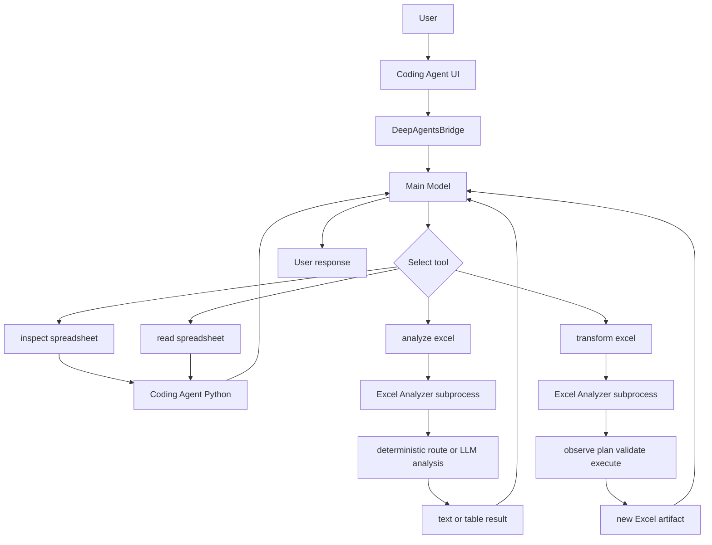

# Coding Agent × Excel Analyzer 연계 보고

Excel Analyzer를 Coding Agent에 연계하여, 자연어로 Excel 파일을 조회·분석·변환하는 기능을 구현한 현황을 보고한다.

---

## 요약

| 항목 | 내용 |
|---|---|
| 연계 방식 | Excel Analyzer를 Coding Agent의 별도 subprocess 도구로 연결 |
| 사용자 기능 | 자연어로 구조 확인, 데이터 읽기, 분석, 변환 요청 |
| 설계 | LLM은 의미 판단, Python은 관찰·검증·결정적 실행 |
| 안전 | Excel 연계 경로는 원본을 덮어쓰지 않고 request-scoped 결과를 사용 |
| 검증된 범위 | 구조 확인·표본 읽기·분석(UI), 병합 셀 분리 변환(UI·artifact 검증 **PASS**) |
| 시연 가능 | 파일 확인, 구조 확인, 단일값 조회, 병합 셀 분리 |
| 연구·개선 중 | 복잡한 다단 헤더·다중 그룹 추출(새 sheet), 임의 양식 일반화 |

본 보고는 특정 시연 파일·환경에서의 검증 결과이다. 모든 Excel 파일에서 동일한 성공을 보장하지는 않는다.

---

## 1. 프로젝트 개요

사용자가 Coding Agent에 Excel 작업을 자연어로 요청하면, Coding Agent가 적합한 Excel 도구를 선택한다. 구조 확인과 제한된 읽기는 Coding Agent가 직접 처리하고, 분석·변환은 Excel Analyzer가 수행한다.

`analyze_excel`과 `transform_excel` 연계 경로는 원본을 덮어쓰지 않고 request-scoped 결과 경로를 사용하도록 설계됐다. 결과는 설명 문장 또는 **새 Excel 파일**로 반환된다.

**목적:** Excel 전문 작업을 Coding Agent 환경에서 하나의 대화 흐름으로 통합하는 것이다.

---

## 2. 개발 목적과 배경

| 기존 한계 | 대응 방향 |
|---|---|
| 사용자가 시트 구조·셀 좌표·경우에 따라 코드를 직접 알아야 함 | 자연어 요청으로 작업 지시 |
| 다단 헤더·병합 셀이 있는 실무 양식 처리가 어려움 | Excel 전문 모듈(Excel Analyzer)에 위임 |
| Coding Agent만으로 Excel 전문 기능을 안전하게 수행하기 어려움 | 역할 분리 및 subprocess 격리 |
| 외부 기능 연결 시 경로 이탈·원본 훼손·장시간 프로세스 위험 | workspace 제한, 연계 경로의 원본 보존, timeout |

---

## 3. 전체 시스템 구조

아래 그림은 Markdown Preview에서 확인한다.



| 경로 | 처리 흐름 |
|---|---|
| `inspect_spreadsheet` | Coding Agent Python에서 workbook 구조 확인 |
| `read_spreadsheet` | Coding Agent Python에서 제한된 행 읽기 |
| `analyze_excel` | Excel Analyzer subprocess → deterministic route 또는 LLM 분석 → 텍스트/표 결과 |
| `transform_excel` | Excel Analyzer subprocess → 관찰 → 계획 → 검증 → 실행 → 새 artifact 검사 |

`analyze_excel`이 항상 planner·executor·artifact 생성을 수행한다고 보지 않는다. 분석 요청은 경로에 따라 텍스트 요약만 반환할 수 있다.

---

## 4. Coding Agent와 Excel Analyzer의 역할

| 구성 | 역할 |
|---|---|
| Coding Agent UI | 대화, workspace 파일 확인, 결과·Files 표시 |
| DeepAgentsBridge | UI와 Agent 실행 연결 |
| Coding Agent main model | 사용자 의도 해석, 도구 선택, 최종 설명 생성 |
| `inspect_spreadsheet` / `read_spreadsheet` | 시트·열 구조 및 제한된 행 조회 (LLM 미사용) |
| `analyze_excel` | 분석 요청을 Analyzer로 전달 |
| `transform_excel` | 변환 요청을 Analyzer로 전달 |
| Excel Analyzer CLI | 전용 환경에서 요청 수신·처리 |
| planner | 변환 경로에서 자연어를 계획으로 해석 |
| validator / contracts | 변환 계획이 workbook·스키마와 맞는지 검사 |
| executor | 검증된 변환만 결정적으로 실행 |
| artifact validation | 결과 파일의 경로·존재·형식을 Coding Agent가 재확인 |

Coding Agent는 Excel Analyzer를 코드로 import하지 않고, 전용 Python 환경의 subprocess로만 호출한다.

---

## 5. 지원 기능과 상태

| 기능 | 사용자 요청 예시 | 사용 도구 | 결과 | 상태 |
|---|---|---|---|---|
| 파일 구조 확인 | 시트와 열을 알려줘 | `inspect_spreadsheet` | 구조 정보 | 시연 가능 (UI 확인) |
| 데이터 읽기 | 처음 몇 행을 보여줘 | `read_spreadsheet` | 표본 데이터 | 시연 가능 (UI 확인) |
| 데이터 분석·조회 | 특정 행·열 조건을 지정해 값을 알려줘 | `analyze_excel` 또는 읽기 도구 | 분석·조회 결과 | 시연 가능 (조건 명확화 권장) |
| 병합 셀 분리 | 병합을 해제하고 값을 채워 새 파일을 만들어줘 | `transform_excel` | 새 결과 파일 | **PASS / 시연 가능** (UI·artifact 검증) |
| 복합 의미 추출 | 특정 열·여러 행 그룹만 다른 sheet로 | `transform_excel` | 새 sheet/파일 | **연구·개선 중** (본 시연 제외) |

---

## 6. 자연어 요청 처리 과정

1. 사용자가 자연어로 요청한다.  
2. Coding Agent가 도구 설명을 바탕으로 적합한 도구를 선택한다.  
3. 입력 파일 경로와 workspace 안전성을 확인한다.  
4. **inspect/read**는 Coding Agent Python이 바로 처리한다.  
5. **analyze**는 Excel Analyzer subprocess로 전달되어 deterministic route 또는 LLM 분석을 수행한다.  
6. **transform**은 관찰 → 계획 → 검증 → 실행 후, Coding Agent가 새 artifact를 검사한다.

도구 선택은 특정 모델 전용 하드코딩 routing이 아니라, 등록된 도구 설명과 사용자 요청을 기준으로 Agent가 수행한다.

---

## 7. LLM과 Python의 책임 분리

| 영역 | 담당 |
|---|---|
| 사용자 의도와 의미 판단 | LLM |
| workbook 구조 관찰 | Python |
| 계획 형식 및 근거 검증 | Python validator / contracts |
| 실제 셀·시트 변경 | deterministic executor (transform만) |
| 경로 및 파일 안전성 | Python |
| 최종 사용자 설명 | Coding Agent main model |

시연용 파일명·열 이름·셀 좌표를 production 코드에 하드코딩하지 않았다.

---

## 8. 안전장치

| 항목 | 내용 |
|---|---|
| workspace containment | 허용된 workspace 내부 경로만 사용 |
| 경로 | workspace 내부 상대·절대 경로 허용, 외부·symlink escape 차단 |
| shell | Analyzer 호출은 `shell=False` |
| 프로세스 격리 | 별도 subprocess 및 전용 Python 환경 |
| timeout | 제한 시간 초과 시 process group 종료 |
| 출력 | 요청별 `outputs/excel_agent/<request_id>/` |
| Excel 연계 원본 보호 | `analyze_excel` / `transform_excel`는 원본 overwrite 없이 request-scoped 결과 사용 |
| artifact | 존재·경로·형식 검증 |
| 변환 계획 검증 | 스키마·근거 불일치 시 실행 차단 |

Excel 연계 도구의 no-overwrite 설계와 Coding Agent의 generic 파일 편집 능력은 별개다. 시연에서는 원본 `.xlsx`에 대한 수정 승인 요청이 나오면 승인하지 않는다. 병합 해제 시연에서는 해당 승인 요청이 발생하지 않았다.

---

## 9. 확정된 시연 항목

시연 대상 파일: `04_분산_예실대비표.xlsx`

### 시연 1 — 파일 확인

**상태:** 시연 가능

```text
현재 workspace에 있는 Excel 파일 목록을 알려줘. 내용을 분석하거나 변경하지는 마.
```

### 시연 2 — 구조 확인

**상태:** 시연 가능

```text
04_분산_예실대비표.xlsx의 시트 이름, 행과 열 크기, 주요 열 이름을 알려줘. 파일은 변경하지 마.
```

### 시연 3 — 단일값 조회 (개별 행)

**상태:** 시연 가능

```text
04_분산_예실대비표.xlsx의 Sheet1에서 ‘비목분류’ 열의 값이 ‘내부인건비’이고, 동시에 ‘비용명’ 열의 값도 정확히 ‘내부인건비’인 행을 찾아줘. 그 행의 ‘실행예산’ 하위 열 중 ‘이월예산’ 값을 알려줘. 같은 비목분류에 속한 다른 비용명 행은 합산하지 마. 분석만 수행하고 어떤 파일도 수정하거나 새로 만들지 마. 반드시 한국어로만 답변해줘.
```

### 시연 3b — 분류 합계 조회 (선택)

**상태:** 시연 가능 (비교 설명용)

```text
04_분산_예실대비표.xlsx의 Sheet1에서 ‘비목분류’가 ‘내부인건비’인 세부 항목들의 ‘실행예산’ 하위 ‘이월예산’ 합계를 알려줘. 소계 행은 제외해. 분석만 수행하고 파일은 수정하지 마. 한국어로만 답변해줘.
```

### 시연 4 — 병합 셀 분리

**상태:** PASS / 시연 가능

```text
04_분산_예실대비표.xlsx의 모든 병합 셀을 개별 셀로 나누고, 기존 병합 셀의 값을 나누어진 모든 셀에 채운 새 Excel 파일을 만들어줘. 원본 파일은 수정하지 마.
```

---

## 10. 기대 결과와 실제 검증

| 시연 | 기대 결과 | PASS 조건 |
|---|---|---|
| 1 | `04_분산_예실대비표.xlsx` 목록 확인 | 파일명 확인, 내용 변경 없음 |
| 2 | Sheet1, 약 28행 × 18열(조회 도구 기준), 주요 열 이름 | 구조 정보 일치, 원본 미변경 |
| 3 | **186,680원** (개별 행) | 비목분류·비용명이 모두 `내부인건비`인 행의 이월예산 |
| 3b | **10,186,680원** (분류 합계) | 비목분류=`내부인건비` 세부 항목 이월예산 합, 소계 제외 |
| 4 | 새 결과 파일, 병합 0개, fill_all | 아래 검증 결과 표 |

### 시연 3 / 3b 해석

`내부인건비`는 **비목분류**와 **비용명**에 모두 나타날 수 있다.

| 질문 유형 | 필터 | 기대값 | 의미 |
|---|---|---:|---|
| 개별 행 (시연 3) | 비목분류=`내부인건비` **그리고** 비용명=`내부인건비` | 186,680 | 한 행의 이월예산 |
| 분류 합계 (시연 3b) | 비목분류=`내부인건비`인 세부 항목 합 (소계 제외) | 10,186,680 | 같은 비목분류 하위 항목들의 이월예산 합 |

두 숫자의 차이는 계산 오류가 아니라 **필터 조건 차이**다. 모호한 “내부인건비 항목” 질문에는 모델이 합계(10,186,680)로 답할 수 있으므로, 시연에서는 시연 3 문장처럼 열 조건을 명시한다.

### 시연 4 — 병합 해제 실제 검증 결과

| 항목 | 결과 |
|---|---|
| 최종 판정 | **PASS / 시연 가능** |
| UI 도구 | `transform_excel` 1회 |
| 원본 | `/home/raven323/Project/coding_agent/workspace/04_분산_예실대비표.xlsx` |
| 결과 artifact | `.../outputs/excel_agent/ab01f5c43c8f4b6dbaf8c721011b2e5f/ab01f5c43c8f4b6dbaf8c721011b2e5f_transformed.xlsx` |
| 원본 병합 | 14개 |
| 결과 병합 | 0개 |
| 값 채움 | 원본 14개 범위 모두 top-left 값을 분리된 전 셀에 채움 |
| 구조 | Sheet1, 29×18 유지 |
| 병합 외 셀 값 | 일치 |
| 서식 | 열 너비·행 높이·주요 셀 서식 유지 |
| 재개방 | 정상 |
| 원본 SHA-256 | `a4c66ccaf708563f02eaa7367e12fde31d1eb02178b8b4760cef53ea8941f4d4` (불변) |
| 저장 방식 | 원본 overwrite 없음, request-scoped 별도 artifact |
| 최종 응답 언어 | 한국어 |
| 이상 징후 | recursion·반복 실패·workspace violation·generic `edit_file` 승인 요청 없음 |

참고: Files/미리보기에서 `비용명.1`, `실행예산.1`처럼 보이면, 이는 병합 해제 후 동일 헤더 문자열이 여러 열에 채워진 것을 pandas 등이 구분하기 위해 붙인 **표시용 접미사**이며, 실제 workbook이 그 문자열을 열 이름으로 저장했다는 뜻이 아니다.

---

## 11. 현재 한계

- 복잡한 다단 헤더와 여러 행 그룹을 동시에 골라 **다른 sheet로 추출**하는 기능은 연구·개선 중이며, 본 시연에서 실행하지 않는다.
- 자연어 조건이 모호하면 개별 행 값과 분류 합계를 혼동할 수 있다. 열·행 조건을 명시해야 한다.
- 모델·프롬프트에 따라 최종 응답 언어가 흔들릴 수 있어, 시연 문장에 한국어 답변을 명시하는 것이 안전하다.
- 모든 임의 Excel 형식에서 동일한 성공을 보장하지 않는다.
- Excel 연계 도구 외 generic 파일 편집이 원본을 대상으로 승인 요청될 수 있으므로, 해당 승인은 거부한다.

**본 시연에서 제외**

- 실행예산 중 당해예산 열만 선택해 다른 sheet로 옮기기
- 내부인건비·재료비 등 여러 행 그룹만 추출
- Scenario A형 복합 의미 추출 전체

---

## 12. 향후 개선 방향

- 복잡한 header grounding 및 다중 그룹 추출 정확도 개선  
- 자연어 필터(개별 행 vs 분류 합계) 혼동 완화  
- 한국어 최종 응답 안정화  
- 모델별 정확도·속도 비교  
- 다양한 Excel 형식 회귀 테스트  
- research 기능의 production 이전은 별도 검증 후 검토  

---

## 부록. 기술 근거 (요약)

| 항목 | 내용 |
|---|---|
| 도구 | `inspect_spreadsheet`, `read_spreadsheet`, `analyze_excel`, `transform_excel` |
| Analyzer 호출 | `shell=False` subprocess |
| 출력 | `workspace/outputs/excel_agent/<request_id>/` |
| Excel 모델 | `qwen2.5:7b` (Coding Agent main과 분리) |
| 시연 파일 | `04_분산_예실대비표.xlsx` |
| 내부 준비 문서 | `docs/excel_integration_center_director_demo_guide.md` |

**문서 끝.**
