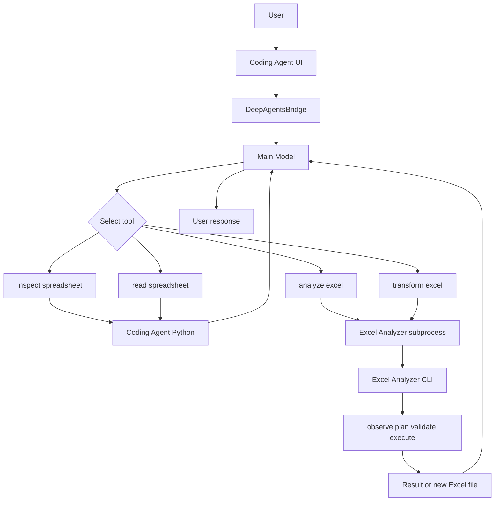

# Coding Agent × Excel Analyzer 연계 보고

Excel Analyzer를 Coding Agent에 연계하여, 자연어로 Excel 파일을 조회·분석·변환하는 기능을 구현한 현황을 보고한다.

---

## 요약

| 항목 | 내용 |
|---|---|
| 연계 방식 | Excel Analyzer를 Coding Agent의 별도 subprocess 도구로 연결 |
| 사용자 기능 | 자연어로 구조 확인, 데이터 읽기, 분석, 변환 요청 |
| 설계 | LLM은 의미 판단, Python은 관찰·검증·결정적 실행 |
| 안전 | 원본 보존, workspace 경로 제한, artifact 검증 |
| 검증된 범위 | 구조 확인·표본 읽기·단일값 조회 경로 |
| 연구·개선 중 | 복잡한 다단 헤더·다중 그룹 추출, 한국어 최종 응답 안정화 |
| 병합 셀 분리 | 기능 경로는 구현됨. 화면 시연 확정은 UI dry-run 이후 |

---

## 1. 프로젝트 개요

사용자가 Coding Agent에 Excel 작업을 자연어로 요청하면, Coding Agent가 적합한 Excel 도구를 선택한다. 구조 확인과 제한된 읽기는 Coding Agent가 직접 처리하고, 분석·변환은 Excel Analyzer가 수행한다. 원본 파일은 덮어쓰지 않으며, 결과는 설명 또는 **새 Excel 파일**로 반환한다.

**목적:** Excel 전문 작업을 Coding Agent 환경에서 하나의 대화 흐름으로 통합하는 것이다.

---

## 2. 개발 목적과 배경

| 기존 한계 | 대응 방향 |
|---|---|
| 사용자가 시트 구조·셀 좌표·경우에 따라 코드를 직접 알아야 함 | 자연어 요청으로 작업 지시 |
| 다단 헤더·병합 셀이 있는 실무 양식 처리가 어려움 | Excel 전문 모듈(Excel Analyzer)에 위임 |
| Coding Agent만으로 Excel 전문 기능을 안전하게 수행하기 어려움 | 역할 분리 및 subprocess 격리 |
| 외부 기능 연결 시 경로 이탈·원본 훼손·장시간 프로세스 위험 | workspace 제한, 원본 보존, timeout |

---

## 3. 전체 시스템 구조

아래 그림은 Markdown 미리보기에서 확인한다. (편집기 원본 화면에서는 코드 블록으로만 보인다.)



동일 흐름(한글):

```text
사용자
  -> Coding Agent UI
  -> DeepAgentsBridge
  -> Coding Agent main model
  -> Excel 도구 선택
       |-- inspect_spreadsheet / read_spreadsheet
       |      -> Coding Agent Python (구조·표본 조회)
       |      -> main model -> 사용자 응답
       |
       `-- analyze_excel / transform_excel
              -> Excel Analyzer subprocess
              -> Excel Analyzer CLI
              -> 관찰 / 계획 / 검증 / 실행
              -> 분석 결과 또는 새 Excel 파일
              -> main model -> 사용자 응답
```

`inspect_spreadsheet`와 `read_spreadsheet`는 Coding Agent 프로세스에서 실행되며 Excel Analyzer subprocess를 **거치지 않는다**.  
`analyze_excel`과 `transform_excel`만 Excel Analyzer CLI로 전달된다.

---

## 4. Coding Agent와 Excel Analyzer의 역할

| 구성 | 역할 |
|---|---|
| Coding Agent UI | 대화, workspace 파일 확인, 결과·Files 표시 |
| DeepAgentsBridge | UI와 Agent 실행 연결 |
| Coding Agent main model | 사용자 의도 해석, 도구 선택, 최종 설명 생성 |
| `inspect_spreadsheet` / `read_spreadsheet` | 시트·열 구조 및 제한된 행 조회 (LLM 미사용) |
| `analyze_excel` / `transform_excel` | 분석·변환 요청을 Analyzer로 전달 |
| Excel Analyzer CLI | 전용 환경에서 요청 수신·처리 |
| planner | 자연어를 변환 계획으로 해석 |
| validator | 계획이 실제 workbook 관찰 결과와 맞는지 검사 |
| executor | 검증된 계획만 결정적으로 실행 |
| artifact validation | 결과 파일의 경로·존재·형식을 Coding Agent가 재확인 |

Coding Agent는 Excel Analyzer를 코드로 import하지 않고, 전용 Python 환경의 subprocess로만 호출한다.

---

## 5. 구현한 Excel 기능

| 기능 | 사용자 요청 예시 | 사용 도구 | 결과 | 상태 |
|---|---|---|---|---|
| 파일 구조 확인 | 시트와 열을 알려줘 | `inspect_spreadsheet` | 구조 정보 | 검증됨 |
| 데이터 읽기 | 처음 몇 행을 보여줘 | `read_spreadsheet` | 표본 데이터 | 검증됨 |
| 데이터 분석·조회 | 특정 항목 값을 알려줘 | `analyze_excel` 또는 읽기 도구 | 분석·조회 결과 | 검증됨 (응답 언어는 시연 전 확인) |
| Excel 변환 | 병합 셀을 나눠줘 | `transform_excel` | 새 결과 파일 | 구현됨 · **화면 dry-run 후 시연 확정** |
| 복합 의미 추출 | 특정 열·여러 행 그룹만 다른 sheet로 | `transform_excel` | 새 sheet/파일 | **연구·개선 중** (본 보고 시연 제외) |

---

## 6. 자연어 요청 처리 과정

1. 사용자가 자연어로 요청한다.  
2. Coding Agent가 도구 설명을 바탕으로 적합한 도구를 선택한다.  
3. 입력 파일 경로와 workspace 안전성을 확인한다.  
4. 구조·표본 조회면 Coding Agent Python이 바로 처리한다.  
5. 분석·변환이면 요청을 Excel Analyzer subprocess로 전달한다.  
6. Excel Analyzer가 workbook을 관찰한다.  
7. LLM이 필요한 의미를 판단해 계획을 만든다.  
8. Python validator가 계획을 검증한다.  
9. deterministic executor가 실행한다.  
10. Coding Agent가 결과 artifact를 검사한 뒤 사용자에게 설명한다.

도구 선택은 특정 모델 전용 하드코딩 routing이 아니라, 등록된 도구 설명과 사용자 요청을 기준으로 Agent가 수행한다.

---

## 7. LLM과 Python의 책임 분리

| 영역 | 담당 |
|---|---|
| 사용자 의도와 의미 판단 | LLM |
| workbook 구조 관찰 | Python |
| 계획 형식 및 근거 검증 | Python validator |
| 실제 셀·시트 변경 | deterministic executor |
| 경로 및 파일 안전성 | Python |
| 최종 사용자 설명 | Coding Agent main model |

시연용 파일명·열 이름·셀 좌표를 production 코드에 하드코딩하지 않았다. 실행은 요청 내용과 workbook 관찰 결과에 따라 동적으로 처리한다.

---

## 8. 안전장치

| 항목 | 내용 |
|---|---|
| workspace containment | 허용된 workspace 내부 경로만 사용 |
| 경로 허용 범위 | workspace 내부 상대·절대 경로 허용 |
| 차단 | 외부 경로, sibling-prefix, symlink escape |
| shell | Analyzer 호출은 `shell=False` |
| 프로세스 격리 | 별도 subprocess 및 전용 Python 환경 |
| timeout | 제한 시간 초과 시 process group 종료 |
| 출력 | 요청별 `outputs/excel_agent/<request_id>/` |
| 원본 | overwrite 금지, 실행 후 무결성 확인 |
| artifact | 존재·경로·형식 검증 |
| 계획 검증 | evidence mismatch 등 근거 불일치 시 실행 차단 |

---

## 9. 실제 시연 항목과 자연어 요청

시연 대상 파일: `04_분산_예실대비표.xlsx`

### 시연 1 — 파일 확인

**상태:** 시연 가능

```text
현재 workspace에 있는 Excel 파일 목록을 알려줘. 내용을 분석하거나 변경하지는 마.
```

### 시연 2 — 구조 확인

**상태:** 시연 가능

```text
04_분산_예실대비표.xlsx의 시트 이름, 행과 열 크기, 주요 열 이름을 알려줘. 파일은 변경하지 마.
```

### 시연 3 — 단일값 조회

**상태:** 시연 가능 (시연 직전 응답 언어 확인)

```text
04_분산_예실대비표.xlsx의 Sheet1에서 내부인건비 항목의 계획예산 값을 알려줘. 분석만 수행하고 어떤 파일도 수정하지 마.
```

### 시연 4 — 병합 셀 분리

**상태:** 시연 전 검증 필요 (UI dry-run 미완. 통과 후 확정)

```text
04_분산_예실대비표.xlsx의 모든 병합 셀을 개별 셀로 나누고, 기존 병합 셀의 값을 나누어진 모든 셀에 채운 새 Excel 파일을 만들어줘. 원본 파일은 수정하지 마.
```

---

## 10. 각 시연 항목의 기대 결과

| 시연 | 기대 결과 | PASS 조건 |
|---|---|---|
| 1 | workspace에 `04_분산_예실대비표.xlsx` 존재 확인 | 파일명 확인, 내용 변경 없음 |
| 2 | Sheet1, 약 28행 × 18열(조회 도구 기준), 주요 열 이름 표시 | 구조 정보 일치, 원본 미변경 |
| 3 | **31,610,000원** | 숫자 일치, 원본 미변경 |
| 4 | `transform_excel` 결과 새 파일 생성 | 원본 merge 14 유지, 결과 merge 0, 좌상단 값 채움, `outputs/excel_agent/<request_id>/` 저장, 원본 SHA 불변 |

시연 2 참고: Excel 전체 사용 범위는 최대 29행으로 보일 수 있다. 조회 도구는 헤더 처리 방식으로 행 수가 28로 표시될 수 있으며, 이는 오류가 아니다.

시연 3 참고: 검증된 기준값은 내부인건비 상세 행의 실행예산·당해예산 저장값이다. 표 헤더의 `계획예산`은 D열 라벨이므로, 판정은 **숫자 일치**를 우선한다.

---

## 11. 현재 검증된 범위

| 구분 | 내용 |
|---|---|
| 통합 | Coding Agent에 Excel 분석·변환 도구가 subprocess로 연결됨 |
| 조회 | 구조 확인·제한 행 읽기 경로 동작 |
| 경로 안전 | workspace 내부 경로 허용, 외부·symlink 이탈 차단 |
| 원본 보존 | 변환 시 원본 overwrite 없이 별도 결과 디렉터리 사용 |
| 변환 기능 | `extract_to_sheet`, `unmerge_cells` 등 변환 경로 구현 |
| 병합 해제 계획 | 관련 planning 검증에서 안정적 결과 확인. **화면 E2E dry-run은 별도 필요** |

---

## 12. 현재 한계

- 다단 헤더와 여러 행 그룹을 동시에 정확히 고르는 **복합 의미 추출**은 연구·개선 중이다.
- 모델이 잘못된 근거를 제시하면 validator가 실행을 차단할 수 있다.
- 최종 사용자 응답에서 언어 drift가 관찰되어, 시연 전 모델·언어 설정 확인이 필요하다.
- 병합 셀 분리는 기능이 구현되어 있으나, 화면 시연 확정 전 UI dry-run이 필요하다.
- 모델 변경 시 schema 준수·timeout·정확성을 다시 검증해야 한다.
- 모든 임의 Excel 형식에서 완전한 성공을 보장하지 않는다.

**본 보고 시연에서 제외하는 요청 유형**

- 실행예산 중 당해예산 열만 선택
- 내부인건비·재료비 등 여러 행 그룹만 선택
- 필요한 행·열만 다른 sheet로 이동

위 유형은 실패를 시연하는 항목이 아니라, 아직 안정 범위 밖인 **연구·개선 중 기능**이다.

---

## 13. 향후 개선 방향

- 복잡한 header grounding 정확도 개선  
- evidence claim 정확성 개선  
- 한국어 최종 응답 안정화  
- 모델별 정확도·속도 비교  
- timeout 및 prompt 크기 최적화  
- 다양한 Excel 형식 회귀 테스트  
- research 기능의 production 이전은 별도 검증 후 검토  

---

## 부록. 기술 근거 (요약)

| 항목 | 근거 |
|---|---|
| 도구 구성 | `inspect_spreadsheet`, `read_spreadsheet`, `analyze_excel`, `transform_excel` |
| Analyzer 호출 | `shell=False` subprocess, process group timeout |
| 출력 위치 | `workspace/outputs/excel_agent/<request_id>/` |
| Excel Analyzer 모델 | 기본 `qwen2.5:7b` (Coding Agent main model과 분리) |
| 시연 파일 | `04_분산_예실대비표.xlsx` |
| 내부 시연 준비 상세 | `docs/excel_integration_center_director_demo_guide.md` |
| 통합 기술 설명 | `docs/excel_integration.md` |

**문서 끝.**
